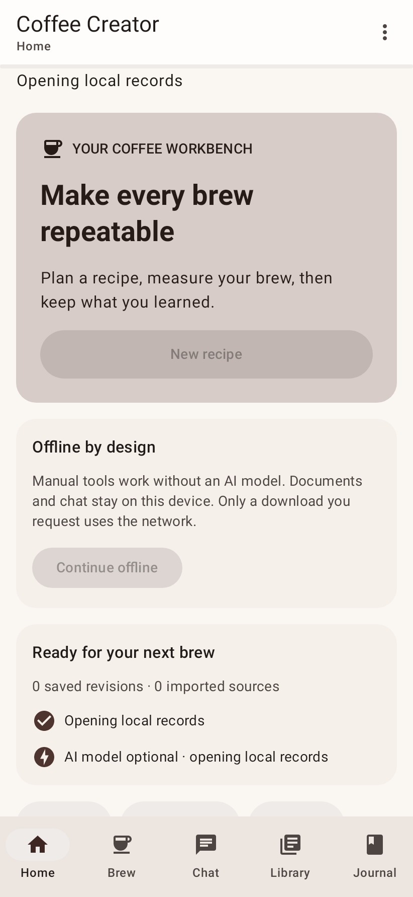
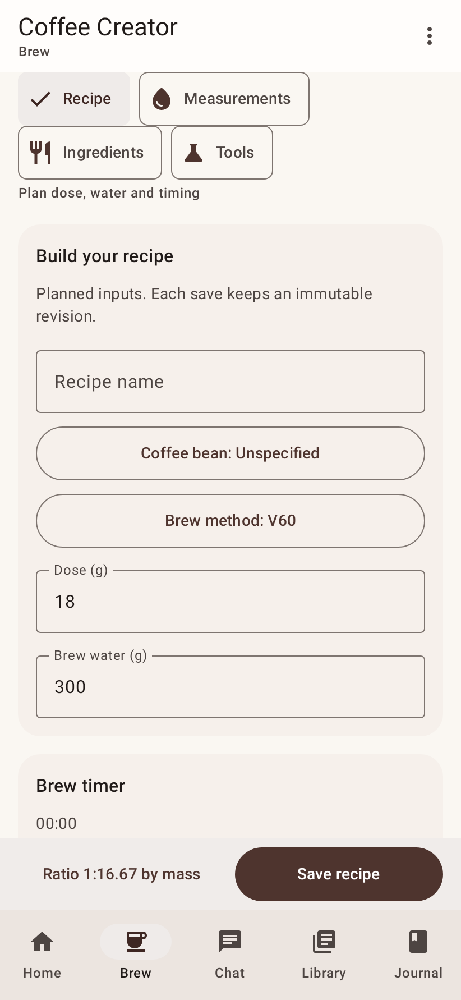
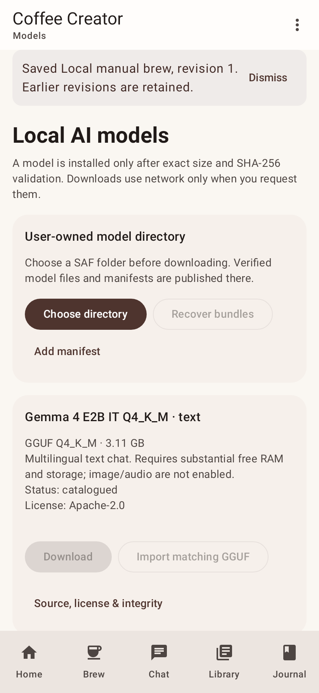

# Coffee Creator

Native Android coffee workbench: manual formulation, measured brew calculations,
versioned journals, sensory records, and optional offline AI over your own sources.
Kotlin, Jetpack Compose, Material 3, Coroutines/Flow and Clean Architecture boundaries.
No account, cloud inference or telemetry. Only an asset download you request uses
network access; models need a first-time install before natural-language chat.

## Download

## Download

[Download the latest debug preview APK (v1.7.0)](https://github.com/Adrian463588/coffee-creator/releases/download/v1.7.0/coffee-creator-v1.7.0.apk)
· [Release notes](docs/releases/v1.7.0.md)
· [SHA-256 checksums](https://github.com/Adrian463588/coffee-creator/releases/download/v1.7.0/SHA256SUMS.txt)

The distribution APK is debug-signed, targets Android 8/API 26+ and arm64-v8a/x86_64.
The physical test reference is Samsung SM-G988B, Android 13/API 33. Other device/RAM/
provider tiers are separate validation work; see [verification](docs/VERIFICATION.md).
Install an APK from GitHub using Android's explicit install permission. For ADB:

```powershell
adb install --user 0 -r coffee-creator-v1.7.0.apk
```

Replacement installation preserves app records when the signing key matches.
Uninstall removes private records/grants; export a backup first if you want them back.

| Version | Date | APK | History |
|---|---|---|---|
| v1.7.0 | 2026-10-15 | [Download](https://github.com/Adrian463588/coffee-creator/releases/download/v1.7.0/coffee-creator-v1.7.0.apk) | [Notes](docs/releases/v1.7.0.md) · Epic S2-E06: Offline personal palate quiz, Bayesian taste adaptation, explainable inventory recommendations, single-variable OVAT feedback loop, OCR coffee bag scanner, grounded AI barista chat, schema-validated tools, persona presets, weather/altitude boiling point thermodynamics, and food-grade safety & allergen warnings |
| v1.6.0 | 2026-10-15 | [Historical APK](https://github.com/Adrian463588/coffee-creator/releases/download/v1.6.0/coffee-creator-v1.6.0.apk) | [Notes](docs/releases/v1.6.0.md) · Epic S2-E05: Hierarchical flavor wheel, accessible list alternative, safe food-grade calibration reference lab, blind cupping sessions with controlled reveal, multi-evaluator consensus & IRAI agreement, physical green/roasted QC, and roast-rest degassing curve |
| v1.5.0 | 2026-10-15 | [Historical APK](https://github.com/Adrian463588/coffee-creator/releases/download/v1.5.0/coffee-creator-v1.5.0.apk) | [Notes](docs/releases/v1.5.0.md) · Epic S2-E04: Brew journal, espresso dial-in progression, single-variable OVAT suggestions, side-by-side numeric deltas, calendar streak, caffeine estimation, and Beanconqueror JSON import |
| v1.4.0 | 2026-10-15 | [Historical APK](https://github.com/Adrian463588/coffee-creator/releases/download/v1.4.0/coffee-creator-v1.4.0.apk) | [Notes](docs/releases/v1.4.0.md) · Epic S2-E03: Active brew timer, BLE scale abstraction, rolling flow rate (g/s), swirl artifact filter, auto-start/stop, proximity cues, and journal logging |
| v1.3.0 | 2026-10-15 | [Historical APK](https://github.com/Adrian463588/coffee-creator/releases/download/v1.3.0/coffee-creator-v1.3.0.apk) | [Notes](docs/releases/v1.3.0.md) · Epic S2-E02: Recipe composer, Hamilton-Hare pour scaling, optical Brix→TDS refractometer lab, expert dial-in, and offline Android Sharesheet |
| v1.2.0 | 2026-10-15 | [Historical APK](https://github.com/Adrian463588/coffee-creator/releases/download/v1.2.0/coffee-creator-v1.2.0.apk) | [Notes](docs/releases/v1.2.0.md) · Modern UI cards, FlowRow chip Brew navigation, custom bean/method inputs, curated library (10 recipes, 8 single-origins, 5 sensory logs) |
| v1.1.0 | 2026-10-15 | [Historical APK](https://github.com/Adrian463588/coffee-creator/releases/download/v1.1.0/coffee-creator-v1.1.0.apk) | [Notes](docs/releases/v1.1.0.md) · Real Room/FTS4 records, local llama.cpp GGUF/ONNX RAG, SAF storage |
| v1.0.0 | 2026-10-13 | [Historical APK](https://github.com/Adrian463588/coffee-creator/releases/download/v1.0.0/coffee-creator-v1.0.0.apk) | Prototype; AI/download/storage paths were simulated. Prefer 1.7.0. |

v1.7.0 APK verification: 121,240,555 bytes, SHA256: `1CB40B36E6DCB734B60656F1E3539AB8BE34722283C85B08B0EEB3FD54A1C9B7`.
Historical 1.6.0 SHA256: `9b2060e67ff69d29aa90468dfd4b00d92f63f78778524f5e6961502764c4958b`.
Historical 1.5.0 SHA256: `99a32c636b467063d451e1a8b0a5dae5f8431ad5a648d3fc126816bc963bfc6f`.
Historical 1.4.0 SHA256: `def99509dadd541a93ae5dfdd81085d1f7af7902ddb92ade38b07895f2bb7712`.
Historical 1.3.0 SHA256: `78ca7128c350c40ab5ff3b4d8148ed09bc7a1a68a0212fc753896f4b91bccc89`.
Historical 1.2.0 SHA256: `4c197fcee278508ee62ba57b3a8ac6524186c9f56ebcc07bce58914335bdf2eb`.
Historical 1.0.0 SHA256: `2843362ff29dd536da78f4263d5e2b66d1a98482c47c1376db037e3439ca02ff`.
[All releases](https://github.com/Adrian463588/coffee-creator/releases).

Local checks: 181 JVM tests pass with 0 failures; Compose UI tested via Robolectric and physical Samsung SM-G988B.
See [requirement checklist and remaining acceptance](docs/VERIFICATION.md).

## Screenshots

Actual local Robolectric/Compose renders from isolated BDD tests, not physical-device
captures. Test recipe values are authored QA inputs, not measured user brews.
The latest UI is tested without ADB, following the user's final testing instruction.

| Home | Formulation | Models |
|---|---|---|
|  |  |  |

## Features

- Search/edit local beans and ingredients; 34 sourced reference cards on a fresh install,
 including 32 newly researched varieties with per-field source receipts. Lot facts remain
 Unknown. See [dataset provenance and reuse restrictions](docs/DATASET.md).
- Brew uses Recipe, Measurements, Ingredients and Tools chips with separate cards,
 persistent input/selection, compact/large-text scrolling, destructive draft Undo
 and a visible Save/ratio bar.
- Mass/volume formulation with density, food-grade/supplier limits and allergen acknowledgement.
- Immutable recipe revisions/copy/compare, timer and human sensory annotations.
- BigDecimal Kotlin math: ratio, approximate extraction, dilution, mass ppm and density conversions.
 18 g dose/270 g measured beverage/1.30% measured TDS gives 19.50% approximate extraction;
 dose/water alone cannot infer TDS. Additives/immersion have explicit limitations.
- Estimated sensory direction has a separately persisted type, basis and uncertainty,
 with no calibrated confidence claim or proprietary SCA graphic.
- Streaming/cancellable local GGUF inference through pinned CPU llama.cpp, editable personas
 and bounded parameters. Missing/unsupported models leave manual workflows usable.
- Real TXT/text-PDF import, bundled offline English OCR, deduplication, ONNX embeddings,
 Room FTS4/ObjectBox HNSW hybrid retrieval and inspectable local sources. No evidence abstains.
- Allowlisted typed tools preserve exact Kotlin outputs. LLM-proposed quantities require
 review; generated recipe saves require confirmation. No runtime shell/browser/network tools.
- User-selected SAF model directory, strict manifest/size/SHA verification, private staging,
 HTTP Range/identity checkpoints, pause/cancel/retry and verified bundle rediscovery.
- Download catalog: Qwen2.5 0.5B (491.40 MB), Kafi Llama3.2 1B (807.69 MB),
 Gemma4 E2B IT Q4_K_M (3.11 GB). All require a selected SAF folder. Actual immutable
 artifacts, licenses, text-only constraints and validation status: [model guide](docs/MODELS.md).
- Complete integrity-checked plaintext SAF backup/restore of records, chat and source metadata.
 Export includes recent draft input; restore replaces stale active/autosaved drafts safely.
 External models and exports are independently owned; deleting records does not delete them.
- Adaptive phone/rail navigation, light/dark, large controls, local diagnostics and privacy settings.

## Architecture

```text
Compose UI -> Hilt ViewModel -> pure model/engine + repository/adapter contracts
  core/model, core/engine: typed quantities, validation, exact scientific math
  core/data: Room records/chunks/FTS4, preserving migrations, transactional backups
  core/ai: llama.cpp JNI, ONNX WordPiece/pooling, ObjectBox VectorStore, typed tools
  core/filesystem: SAF, bounded PDF/Tesseract OCR, WorkManager/OkHttp, Proto DataStore
  ui: immutable lifecycle-aware StateFlow, nine screens, Material3 tokens
  benchmark: physical Startup/FrameTiming/Baseline Profile tests
```

Grouped modular monolith; split modules only for a measured boundary/build benefit.
The [blueprint](coffee-creator-blueprint/PRD.md) governs features. Read [AGENTS](AGENTS.md),
[plan](docs/IMPLEMENTATION_PLAN.md), [ADRs](docs/adr/ADRS.md) and [OpenSpec change](openspec/changes/verified-android-implementation/).
BDD/SDD uses Given/When/Then contracts and planner/developer/independent-review phases,
informed by [OpenSpec](https://github.com/Fission-AI/OpenSpec) and
[BMAD](https://github.com/bmad-code-org/BMAD-METHOD). RTK/Ponytail/Caveman guide authoring only.

## Build and tests

Install JDK 21 (bytecode 17), Android SDK 35/build-tools 35, NDK 27.0.12077973, CMake 3.22.1
and Python3. Set ANDROID_HOME or an ignored local.properties. Android Studio can open
this repository; the Gradle wrapper pins 8.9. Bundled assets are hash-verified and
reproducibly fetched before Gradle; no LLM weights are committed or included in APK.

```powershell
python scripts/prepare_assets.py
.\gradlew.bat :app:lintDebug :app:detekt :app:ktlintCheck :app:testDebugUnitTest :app:assembleDebug :app:assembleDebugAndroidTest
```

For physical offline AI tests, prepare and stage the actual test GGUF according to
[OFFLINE_AI_DEVICE_TEST](docs/OFFLINE_AI_DEVICE_TEST.md), then install the debug and
androidTest APKs with replacement install and run the runner. Existing app/user
records must be preserved. Benchmark instructions/evidence are in verification.
CI runs pinned static/unit/build gates; physical-device outcomes are not inferred
from CI. Re-run regression gates before release. Release CLI workflow is
`scripts/publish_release.ps1`; notes/checksums and source target must match the APK.
Local JVM tests include actual Compose activity/Room execution through Robolectric;
native guard/format tests also run on the host. See [complete evidence and checklist](docs/VERIFICATION.md).

Optional development-only source audit (requires internet; never runs in the app):

```powershell
python -m pip install -r scripts/requirements-research.txt
python scripts/research_reference_catalog.py --verify
```

## Privacy, limits and licenses

No operational network is required after assets are installed. The runtime has
no remote AI API, telemetry or document uploads. Source grants can be revoked;
retained chunks remain inspectable. Automatic Android backups are disabled.
Explicit exports contain personal plaintext records and a corruption checksum,
not encryption/authentication. Keep exports private; regrant SAF after reinstall.

Only verified compatible manifests may be loaded. Tiny models can give incorrect
answers; generated text is labeled unverified and source inspection remains essential.
The authored RAG fixture measures retrieval/tool contracts; independently adjudicated
answer faithfulness, broad provider/RAM/device coverage and field usability are
separate gates listed honestly in verification. No exact flavor prediction is promised.
The last physical RAG run failed at 39/40 direct facts; the subsequent fix passed a
host reproduction at 40/40, with no new Android retest. Kafi/Gemma full transfer and
inference are not claimed tested. This release is a debug preview, not a declaration
that all production/device acceptance gates have passed.

See [third-party assets and licenses](docs/THIRD_PARTY.md). Do not infer an application
license from dependency licenses. Contributions must preserve provenance, scientific
validation, security, accessibility and the blueprint requirements.
