# Coffee Creator

<p align="center">
  
</p>

<p align="center">
  <strong>Native Android Coffee Formulation Workbench, Water Chemistry, Offline BLE Brewing & On-Device AI Lab</strong>
</p>

<p align="center">
  <a href="https://kotlinlang.org"></a>
  <a href="https://developer.android.com/jetpack/compose"></a>
  <a href="https://developer.android.com/design/ui/mobile/guides/foundations/system-overview"></a>
  <a href="https://developer.android.com/about/versions/15"></a>
  <a href="#"></a>
  <a href="#"></a>
  <a href="https://github.com/Adrian463588/coffee-creator/actions"></a>
  <a href="LICENSE"></a>
</p>

---

## ☕ Overview

**Coffee Creator** is a native, offline-first Android coffee laboratory and formulation workbench engineered for professional baristas, roasters, coffee scientists, and passionate home brewers. Built on pure Kotlin scientific calculation engines, strict Clean Architecture boundaries, and a 2026 **Tactile Industrial** Jetpack Compose design system, it provides uncompromising precision from bean agronomy to extraction yield physics and sensory cupping.

### 🌟 Core Architectural Pillars
- **Zero Cloud, Zero Telemetry**: 100% functional in airplane mode. Zero remote analytics, zero cloud inference, zero external API tracking. Network is solely utilized for user-initiated GGUF/OCR downloads.
- **Deterministic Coffee Science**: Pure Kotlin JVM calculation engine (`core/engine`) with zero Android or Room dependencies. Strict `BigDecimal` mass balances for extraction yield, refractometer Brix-to-TDS calibrations, water mineral chemistry ($Ca^{2+}, Mg^{2+}, Na^+, HCO_3^- \to GH/KH/TDS$), and roast-rest degassing kinetics.
- **Tactile Industrial UI (2026 Standards)**: Anti-AI-slop design language featuring physical spring micro-depression (`scale = 0.97f`), haptic confirmations, 1px crisp hairline borders (`alpha = 0.40f`), concentric nested geometry ($R_{inner} = \max(0, R_{outer} - Padding)$), and single-line text constraints preventing bubble distortion.
- **Hardware-Integrated BLE Brewing**: Real-time Bluetooth Low Energy scale abstraction with rolling flow rate ($g/s$), auto-tare, swirl artifact rejection filter, and proximity guidance.
- **On-Device Local AI & RAG**: CPU-accelerated GGUF inference powered by pinned `llama.cpp` JNI, ONNX Runtime vector embeddings, ObjectBox HNSW vector store, and strictly allowlisted, schema-validated Kotlin tools with zero-hallucination abstention.

---

## 📦 Download & Installation

### 🚀 Latest Release: v1.14.4 (Sprint 04 Epic E: Pro Operations, Architecture, AI & Integration)
| Artifact | Size | SHA-256 Checksum |
|---|---|---|
| [**Download coffee-creator-v1.14.4.apk**](https://github.com/Adrian463588/coffee-creator/releases/download/v1.14.4/coffee-creator-v1.14.4.apk) | `117.3 MB` | `a931abbccb6aa77806e85fa677ca774ab33608aa0ac99397bb63c3d8d478bc0f` |

- 📄 [Release Notes for v1.14.4](docs/releases/v1.14.4.md)
- 🔒 [SHA256SUMS.txt](https://github.com/Adrian463588/coffee-creator/releases/download/v1.14.4/SHA256SUMS.txt)
- 📱 **Compatibility**: Android 8.0+ (API level 26 to 35). Architectures: `arm64-v8a`, `x86_64`. Tested on Samsung Galaxy S20 Ultra (`SM-G988B`, serial `RRCN3008VYE`, Android 13/API 33).

### 🛠️ Zero-Data-Loss ADB Installation (Recommended for Development)
To install or upgrade the APK without deleting existing recipes, journal logs, sensory sessions, or Room database state, execute with `-r -d` flags:

```powershell
adb -s RRCN3008VYE install --user 0 -r -d coffee-creator-v1.14.4.apk
```
> [!IMPORTANT]
> The `-r` flag reinstalls the package while **preserving all user data**. The `-d` flag allows sidegrade/downgrade version code safety. Always specify `-s RRCN3008VYE` to target the designated test device. **Never** run `adb uninstall` if you wish to retain local records, as Android purges private databases and revokes SAF folder grants upon uninstallation.

---

## 📜 Historical Release Archive

| Version | Release Date | Download APK | Release Highlights | SHA-256 Checksum |
|:---:|:---:|:---:|:---|:---:|
| **v1.14.4** | 2026-10-18 | [Download](https://github.com/Adrian463588/coffee-creator/releases/download/v1.14.4/coffee-creator-v1.14.4.apk) | [Notes](docs/releases/v1.14.4.md) · **Sprint 04 Epic E: Pro Operations, Architecture, AI & Integration (`S4-052..65`)**: 100% offline operational guarantee, additive Room migration safety, immutable cross-domain provenance linking cupping to bean/roast/recipe/grinder, deterministic standards engine strictly decoupled from LLM, local RAG knowledge citation verification with anti-hallucination guard (`[chunk-cva-desc-04, Page 3]`), blind panel workflow with role separation (Host vs Assessor) and 3-digit randomized codes with premature unblinding audit trail (`UNBLINDED_PREMATURELY_AUDITED`), inter-rater agreement and panel calibration statistics (Pearson $r$, Spearman $\rho$, Mean Consensus Deviation $\text{MCD} \le 0.35$, Fleiss' generalized Kappa $\kappa_{\text{Fleiss}}$ with Landis-Koch benchmarks), bilingual EN/ID glossary, accessibility profiles (anosmia/parosmia accommodation, allergen alerts with non-clinical disclaimer), and user-consent-based export with PII redaction and SHA-256 integrity seal. | `a931abbccb6aa...` |
| **v1.14.3** | 2026-10-18 | [Download](https://github.com/Adrian463588/coffee-creator/releases/download/v1.14.3/coffee-creator-v1.14.3.apk) | [Notes](docs/releases/v1.14.3.md) · **Sprint 04 Epic D: Green Coffee Physical Assessment (`S4-041..51`)**: Complete 350g green lot catalog, provenance & chain of custody, SCA 2004 washed Arabica defect taxonomy (Cat 1 full defects vs Cat 2 weighted equivalents), ISO 4150 sieve distribution with mass balance recovery check ($\Delta M \le 1.5\text{g}$) and Screen 16+ retention %, moisture assessment with meter uncertainty, water activity ($a_w \le 0.700$), density (g/L), organoleptic odor disqualification, deterministic grade rule engine with out-of-scope guards (`UNDETERMINED_OUT_OF_SCOPE`), epistemological decoupling (physical grade $\ne$ cup score), buyer spec contract compliance, and SHA-256 sealed JSON/CSV export. | `e377bf4d7ad80...` |
| **v1.14.2** | 2026-10-18 | [Download](https://github.com/Adrian463588/coffee-creator/releases/download/v1.14.2/coffee-creator-v1.14.2.apk) | [Notes](docs/releases/v1.14.2.md) · **Sprint 04 Epic C: Sensory Training & Testing Lab (`S4-027..40`)**: Blind triangle testing with 6 balanced permutations (`AAB`, `ABA`, etc.), concealed 3-digit keys, exact binomial hypothesis calculus $P(X \ge k)$, 5 basic-taste threshold series (ASTM E679 BET), 60 olfactory reference vials with Sensory SM-2 spaced repetition, confusion matrix, 7 organic-acid comparative tastings, roast defect discrimination, tactile/mouthfeel controls, 2-AFC paired comparisons ($p_0=1/2$), 6-pillar readiness radar, and physical human observation anti-cheating mandate (`isAutoPassed=false`). | `8eff8a4e7feda...` |
| **v1.14.1** | 2026-10-18 | [Download](https://github.com/Adrian463588/coffee-creator/releases/download/v1.14.1/coffee-creator-v1.14.1.apk) | [Notes](docs/releases/v1.14.1.md) · **Sprint 04 Epic B: Digital CVA Cupping & 221-Wheel Integration (`S4-011..26`)**: Multi-sample sessions, protocol selector (`SCA_CVA_CURRENT`, `SCA_2004_LEGACY`, `CUSTOM_RESEARCH`), 4-perspective forms (`Physical`, `Descriptive`, `Affective`, `Extrinsic`), extrinsic blinding gate (`UNBLINDED_PREMATURELY_AUDITED`), 221-descriptor Sensory Wheel modal with bilingual search, 5-bowl multi-cup defect grid (Clean/Taint/Fault), 6-milestone cupping timer, A/B side-by-side comparison, cryptographic SHA-256 session lock, JSON/CSV exports, and 1-click "Log to Brew Journal as Graded Coffee". | `f2415b498e4fb...` |
| **v1.14.0** | 2026-10-17 | [Download](https://github.com/Adrian463588/coffee-creator/releases/download/v1.14.0/coffee-creator-v1.14.0.apk) | [Notes](docs/releases/v1.14.0.md) · **Sprint 04 Professional Sensory, Cupping, CVA & Green Coffee Assessment**: 22-module bilingual Learning Academy (`EDU-01..22`) with quizzes and ASCII diagrams, 5 basic tastes (Sweet, Sour, Salty, Bitter, Umami), 7 organic acids atlas, generic 60-aroma taxonomy, 4-perspective Digital CVA (`Physical`, `Descriptive`, `Affective`, `Extrinsic`) with blind codes, SHA-256 session lock and JSON/CSV exports, 6-permutation balanced Triangle testing with exact cumulative Binomial probability $P(X \ge k)$, and 350g washed Arabica green coffee defect grading. | `350fe44ffeb47...` |
| **v1.13.1** | 2026-10-17 | [Download](https://github.com/Adrian463588/coffee-creator/releases/download/v1.13.1/coffee-creator-v1.13.1.apk) | [Notes](docs/releases/v1.13.1.md) · **Tactile Microinteractions & Anti-AI-Slop Refinement**: Semantic `MicroBadgePill`s (Hand/Electric/Verified/Filter-only), 3-tile monospace grind range grid (`fontFeatureSettings = "tnum"`), animated segmented valve toggle (`InteractiveValveSwitch`), numbered step-by-step zero calibration accordion, and zero text-wrapping distortion. | `5b0a0f542cc2e...` |
| **v1.13.0** | 2026-10-17 | [Download](https://github.com/Adrian463588/coffee-creator/releases/download/v1.13.0/coffee-creator-v1.13.0.apk) | [Notes](docs/releases/v1.13.0.md) · **Sprint 03 Manual Brewing & Grinder Intelligence (`GR-01..12`, `BR-01..18`)**: 44-model grinder catalog with variants, zero calibration wizard, typed grind settings, manufacturer evidence overlay, 26-dripper catalog with qualitative flow classes, filter paper compatibility engine, reversible dial-in assistant, and designated ADB device targeting (`RRCN3008VYE`). | `ba15137a41234...` |
| **v1.12.2** | 2026-10-17 | [Download](https://github.com/Adrian463588/coffee-creator/releases/download/v1.12.2/coffee-creator-v1.12.2.apk) | [Notes](docs/releases/v1.12.2.md) · **Tactile Microinteractions Full-Max & Anti-AI Slop**: Standardized `TactileButton`, `TactileOutlinedButton`, `TactileFilledTonalButton`, `TactileTextButton`, and `TactileFilterChip` with spring micro-depression (`scale = 0.97f`), haptics, single-line text bounds, and zero-data-loss `-r -d` deployment. | `f7358795ea6ee...` |
| **v1.12.1** | 2026-10-17 | [Download](https://github.com/Adrian463588/coffee-creator/releases/download/v1.12.1/coffee-creator-v1.12.1.apk) | [Notes](docs/releases/v1.12.1.md) · **Zero-Crash Resilience**: 5-tier resilient recipe resolution cascade (`resolveActiveRecipe`), defensive coroutines on scale connections, timer sessions, and scale tare operations. | `0b381b2367476...` |
| **v1.12.0** | 2026-10-17 | [Download](https://github.com/Adrian463588/coffee-creator/releases/download/v1.12.0/coffee-creator-v1.12.0.apk) | [Notes](docs/releases/v1.12.0.md) · **Sensory Deepening (Epic S2-E05)**: Full 221-descriptor taxonomy (84 SCA + 137 Indonesian/global), bilingual search (`name` / `idLabel`), 16-attribute CVA cupping, multi-temperature evaluation timeline. | `727e73b709fa5...` |
| **v1.11.0** | 2026-10-17 | [Download](https://github.com/Adrian463588/coffee-creator/releases/download/v1.11.0/coffee-creator-v1.11.0.apk) | [Notes](docs/releases/v1.11.0.md) · **World Champion Recipe Catalog**: 80 curated recipes (21 Competition, 14 Signature, 45 Traditional), 1-click Journal logging, active timer handoff, custom recipe template saving. | `c63f74fcf3bc3...` |
| **v1.10.2** | 2026-10-17 | [Download](https://github.com/Adrian463588/coffee-creator/releases/download/v1.10.2/coffee-creator-v1.10.2.apk) | [Notes](docs/releases/v1.10.2.md) · **Tactile Settings Anti-Slop**: Full-width industrial status banner, 3-column `TelemetryStatusPill` grid with active status dots, tactile chips for language/units/palate quiz. | `b5539ad55f333...` |
| **v1.10.1** | 2026-10-17 | [Download](https://github.com/Adrian463588/coffee-creator/releases/download/v1.10.1/coffee-creator-v1.10.1.apk) | [Notes](docs/releases/v1.10.1.md) · **Custom Precision Lab Launcher Icon**: Master vector emblem (bean + dripper flask + amber drop), dark espresso `#1B120C` background, full mdpi-xxxhdpi mipmaps. | `a8cfc5fccb4ab...` |
| **v1.10.0** | 2026-10-17 | [Download](https://github.com/Adrian463588/coffee-creator/releases/download/v1.10.0/coffee-creator-v1.10.0.apk) | [Notes](docs/releases/v1.10.0.md) · Offline OCR coffee bag scanner, verified Kafi/Gemma model catalog, evidence-safe extraction yield, durable record restore. | `d06e9c6bace08...` |
| **v1.9.6** | 2026-10-16 | [Download](https://github.com/Adrian463588/coffee-creator/releases/download/v1.9.6/coffee-creator-v1.9.6.apk) | [Notes](docs/releases/v1.9.6.md) · Tactile Industrial UI/UX Refinement: 0.97f spring micro-depression, subtle haptics, tabular monospace figures (`tnum`), 1px hairline borders. | `d3d28471fdf73...` |
| **v1.9.5** | 2026-10-16 | [Download](https://github.com/Adrian463588/coffee-creator/releases/download/v1.9.5/coffee-creator-v1.9.5.apk) | [Notes](docs/releases/v1.9.5.md) · Interactive Canvas Sensory Wheel, touch-arc polar hit detection & zoom, commercial defect/taint catalog, multi-select flavor picker dialog. | `d84569a5035fa...` |
| **v1.9.4** | 2026-10-16 | [Download](https://github.com/Adrian463588/coffee-creator/releases/download/v1.9.4/coffee-creator-v1.9.4.apk) | [Notes](docs/releases/v1.9.4.md) · Hardware-verified E2E release: BackHandler sub-screen navigation, restored journal revision list, exception safety. | `d5a0a24c3d4b2...` |
| **v1.9.3** | 2026-10-16 | [Download](https://github.com/Adrian463588/coffee-creator/releases/download/v1.9.3/coffee-creator-v1.9.3.apk) | [Notes](docs/releases/v1.9.3.md) · Anti-slop bag inventory Surface container, single-line action headers, zero word-wrapping distortion into oval buttons. | `0463433500797...` |
| **v1.9.2** | 2026-10-16 | [Download](https://github.com/Adrian463588/coffee-creator/releases/download/v1.9.2/coffee-creator-v1.9.2.apk) | [Notes](docs/releases/v1.9.2.md) · Anti-slop tactile navigation: single-line horizontal scroll rows with M3 icons across Journal and Sensory categories. | `ab068dea442fa...` |
| **v1.9.1** | 2026-10-16 | [Download](https://github.com/Adrian463588/coffee-creator/releases/download/v1.9.1/coffee-creator-v1.9.1.apk) | [Notes](docs/releases/v1.9.1.md) · Precision Lab Timer & Telemetry Console: unified digital readout, live pulse indicator, integrated mass & flow rate, 54dp CTA. | `917f9cdbab661...` |
| **v1.9.0** | 2026-10-15 | [Download](https://github.com/Adrian463588/coffee-creator/releases/download/v1.9.0/coffee-creator-v1.9.0.apk) | [Notes](docs/releases/v1.9.0.md) · **Epic S2-E01**: Bean agronomy, bag freeze/thaw, water chemistry ($Ca^{2+}, Mg^{2+}, Na^+, HCO_3^-$), green coffee QC, roast curves. | `4801d10dbc143...` |
| **v1.8.0** | 2026-10-15 | [Download](https://github.com/Adrian463588/coffee-creator/releases/download/v1.8.0/coffee-creator-v1.8.0.apk) | [Notes](docs/releases/v1.8.0.md) · **Epic S2-E07**: SAF persistent model manifest, resumable downloads (Range/ETag), cryptographic backup/restore, bilingual EN/ID. | `1DC681387D6DE...` |
| **v1.7.0** | 2026-10-15 | [Download](https://github.com/Adrian463588/coffee-creator/releases/download/v1.7.0/coffee-creator-v1.7.0.apk) | [Notes](docs/releases/v1.7.0.md) · **Epic S2-E06**: Offline palate quiz, Bayesian taste adaptation, explainable inventory suggestions, grounded AI barista chat. | `1CB40B36E6DCB...` |
| **v1.6.0** | 2026-10-15 | [Download](https://github.com/Adrian463588/coffee-creator/releases/download/v1.6.0/coffee-creator-v1.6.0.apk) | [Notes](docs/releases/v1.6.0.md) · **Epic S2-E05**: Hierarchical flavor wheel, safe reference preparation lab, blind cupping sessions, consensus radar. | `9b2060e67ff69...` |
| **v1.5.0** | 2026-10-15 | [Download](https://github.com/Adrian463588/coffee-creator/releases/download/v1.5.0/coffee-creator-v1.5.0.apk) | [Notes](docs/releases/v1.5.0.md) · **Epic S2-E04**: Brew journal, espresso dial-in progression, single-variable OVAT suggestions, streak calendar, Beanconqueror I/O. | `99a32c636b467...` |
| **v1.4.0** | 2026-10-15 | [Download](https://github.com/Adrian463588/coffee-creator/releases/download/v1.4.0/coffee-creator-v1.4.0.apk) | [Notes](docs/releases/v1.4.0.md) · **Epic S2-E03**: Active brew timer, BLE scale abstraction, rolling flow rate ($g/s$), swirl artifact filter, proximity cues. | `def99509dadd5...` |
| **v1.3.0** | 2026-10-15 | [Download](https://github.com/Adrian463588/coffee-creator/releases/download/v1.3.0/coffee-creator-v1.3.0.apk) | [Notes](docs/releases/v1.3.0.md) · **Epic S2-E02**: Recipe composer, Hamilton-Hare pour scaling, optical Brix-to-TDS refractometer lab, offline Sharesheet. | `78ca7128c350c...` |
| **v1.2.0** | 2026-10-15 | [Download](https://github.com/Adrian463588/coffee-creator/releases/download/v1.2.0/coffee-creator-v1.2.0.apk) | [Notes](docs/releases/v1.2.0.md) · Curated recipe library (10 methods, 8 single-origins, 5 sensory logs), custom bean/method inputs. | `4c197fcee2785...` |
| **v1.1.0** | 2026-10-15 | [Download](https://github.com/Adrian463588/coffee-creator/releases/download/v1.1.0/coffee-creator-v1.1.0.apk) | [Notes](docs/releases/v1.1.0.md) · Real Room SQLite records, local llama.cpp GGUF/ONNX RAG integration, user-selected SAF model storage. | `e25474341ca5d...` |
| **v1.0.0** | 2026-10-13 | [Download](https://github.com/Adrian463588/coffee-creator/releases/download/v1.0.0/coffee-creator-v1.0.0.apk) | Initial Prototype Release with architectural scaffold and UI layout foundations. | `2843362ff29dd...` |

*(Full verified checksums for all historical artifacts are preserved in [SHA256SUMS.txt](https://github.com/Adrian463588/coffee-creator/releases/download/v1.12.2/SHA256SUMS.txt)).*

---

## 🗺️ User Journey & Workflow Diagram

The complete end-to-end feedback loop in Coffee Creator empowers baristas to move from green/roasted coffee beans through scientific formulation, live smart-scale extraction, professional CVA sensory cupping, and iterative dial-in optimization:

```mermaid
flowchart TD
    subgraph S1["1. Sourcing & Inventory"]
        A["Coffee Bean Agronomy\n(Origin, Varietal, Process, Altitude)"] --> B["Bag Inventory & Rest Calculator\n(Degassing Decay / Freeze Pause)"]
        B --> C["Water Chemistry Mineral Setup\n(Ca2+, Mg2+, Na+, HCO3- -> GH/KH)"]
    end

    subgraph S2["2. Recipe Formulation"]
        C --> D["Recipe Composer\n(Dose, Target Water, Ratio, Grind)"]
        D --> E["Hamilton-Hare Scaling Engine\n(Monotonic Multi-Pour Steps)"]
        E --> F["World Champion Catalog\n(80 Curated Competition/Signature Routines)"]
    end

    subgraph S3["3. Live Extraction Laboratory"]
        F --> G["BLE Smart Scale Connection\n(Acaia, Felicita, Decent, Skale)"]
        G --> H["Precision Chronometer Console\n(Monotonic Clock, Flow Rate g/s, Auto-Tare)"]
        H --> I["Real-Time Pour Guidance\n(Live vs Ideal Target Curve)"]
    end

    subgraph S4["4. Sensory Cupping & Evaluation"]
        I --> J["16-Attribute CVA Cupping Form\n(Fragrance, Aroma, Flavor, Acidity, Body)"]
        J --> K["221-Descriptor Sensory Wheel\n(Canvas Touch Arc, Bilingual EN/ID)"]
        K --> L["Multi-Phase Temperature Timeline\n(Hot 70°C -> Warm 60°C -> Cool 40°C)"]
    end

    subgraph S5["5. Analytics & Dial-In Loop"]
        L --> M["Refractometer Brix -> TDS & EY\n(Mass-Balance Yield Calculation)"]
        M --> N["Side-by-Side Delta Comparison\n(Dose, Yield, Extraction, Taste Deltas)"]
        N --> O["One-Variable-At-A-Time (OVAT) Feedback\n(E.g., Sour -> Grind Finer / Increase Yield)"]
        O -->|Iterative Dial-In| D
    end

    style S1 fill:#251810,stroke:#D4A373,stroke-width:1.5px,color:#fff
    style S2 fill:#1E1A16,stroke:#D4A373,stroke-width:1.5px,color:#fff
    style S3 fill:#181A1B,stroke:#7F52FF,stroke-width:1.5px,color:#fff
    style S4 fill:#1F1916,stroke:#E0A96D,stroke-width:1.5px,color:#fff
    style S5 fill:#1A1F1B,stroke:#34A853,stroke-width:1.5px,color:#fff
```



---

## 🏛️ System Architecture Diagram

Coffee Creator enforces strict Clean Architecture boundaries with unidirectional data flow (UDF). The presentation layer consumes immutable `StateFlow`, the pure Kotlin science engine guarantees mathematical exactness with zero framework dependencies, and all persistent storage operations are isolated behind domain interfaces:

```mermaid
flowchart TD
    subgraph Presentation["Presentation Layer (Jetpack Compose & Material 3)"]
        UI["High-Density Tactile Consoles\n(CoffeeApp, BrewSection, SensoryWheel, Radar)"]
        VM["CoffeeViewModel\n(Lifecycle-Aware StateFlow & Intent Handlers)"]
        UI <-->|Immutable UiState / User Intents| VM
    end

    subgraph Domain["Pure Kotlin Scientific Engine (Zero Android/Room Deps)"]
        EY["Extraction Yield Math\nEY = beverage_mass * TDS / dose"]
        WC["Water Chemistry Engine\nCa/Mg/Na/HCO3 -> Hardness/Alkalinity"]
        HH["Hamilton-Hare Pour Scaler\nMonotonic Ratio & Step Mass Balances"]
        DK["Degassing Kinetics Engine\nRoast-Rest Degradation & Freeze Pause"]
        BT["Brix -> TDS Refractometer Lab\nAtago, VST, Standard Coffee Calibrations"]
        VM -->|Dispatches Calculations| Domain
    end

    subgraph Storage["Data & Storage Repositories"]
        ROOM[("Room SQLite + FTS4\nRecipes, Beans, Journals, Cuppings")]
        OBOX[("ObjectBox Android HNSW\nLocal Vector Store for Hybrid RAG")]
        PROTO["Proto DataStore\nTyped User Settings & Preferences"]
        SAF["Storage Access Framework (SAF)\nUser-Owned Models & Verified Exports"]
        VM -->|Repository Interfaces| Storage
    end

    subgraph Hardware["Local Hardware & Native AI Subsystems"]
        BLE["Android BLE GATT Client\nAcaia / Felicita / Decent Scale Adapters"]
        LLM["llama.cpp JNI Engine\nCPU GGUF Local Inference (Qwen, Kafi, Gemma)"]
        ONNX["ONNX Runtime Engine\nLocal MiniLM Embeddings & Semantic Search"]
        OCR["Offline Tesseract & PDFBox\nCoffee Bag Label & Paper Document Parser"]
        VM -->|Reactive Hardware Streams| Hardware
    end

    style Presentation fill:#2A1B14,stroke:#D4A373,stroke-width:2px,color:#fff
    style Domain fill:#1C241E,stroke:#34A853,stroke-width:2px,color:#fff
    style Storage fill:#1E202B,stroke:#4285F4,stroke-width:2px,color:#fff
    style Hardware fill:#261B2E,stroke:#7F52FF,stroke-width:2px,color:#fff
```

---

## 💻 Modern Technology Stack

| Architecture Domain | Framework / Library | Version | Technical Responsibility |
|---|---|:---:|---|
| **Presentation Framework** | Jetpack Compose BOM | `2024.09.03` | Declarative UI, state hoisting, 2026 Tactile Industrial primitives |
| **Design System** | Material 3 / Expressive Tokens | In BOM | ColorScheme tokens, dynamic typography, concentric geometry |
| **Navigation** | Navigation Compose | `2.8.3` | Single-top back-stack graph with hardware `BackHandler` safety |
| **Core Language & JVM** | Kotlin | `2.0.20` | Pinned compiler, sealed hierarchies, strict typing, JVM 17 bytecode |
| **Asynchronous Streaming** | Kotlinx Coroutines & Flow | `1.9.0` | Reactive state management, background thread dispatching, BLE pipes |
| **Dependency Injection** | Dagger Hilt | `2.52` | Compile-time DI with KSP (`2.0.20-1.0.25`) for modular monolith |
| **Relational Storage** | AndroidX Room & SQLite | `2.6.1` | Type converters, transactional migrations, SQLite FTS4 search |
| **Vector Indexing** | ObjectBox Android | `4.3.1` | Local HNSW high-dimensional vector storage for semantic RAG retrieval |
| **Typed Preferences** | AndroidX Proto DataStore | `1.1.1` | Schema-backed settings (`protobuf-javalite:3.25.3`), non-blocking I/O |
| **File & Asset Storage** | Android Storage Access Framework | `1.0.1` | User-owned external directories (`content://`), zero filesystem assumptions |
| **Science & Math Engine** | Pure Kotlin Engine | Native | Deterministic mass-balance extraction, water mineral ions, degassing kinetics |
| **Local LLM Inference** | llama.cpp Native C++ JNI | Pinned | CPU-optimized GGUF execution (Qwen2.5 0.5B, Kafi Llama-3.2 1B, Gemma 2B) |
| **Vector Embeddings** | ONNX Runtime Android | `1.21.1` | On-device WordPiece tokenization and MiniLM embedding tensor generation |
| **Offline Optical OCR** | Tesseract4Android & PDFBox | `4.9.0` / `2.0.27.0` | On-device bag label parsing and PDF guide text extraction |
| **Hardware Telemetry** | Android BLE GATT Client | Native | Low-latency smart scale communication, rolling flow filter ($g/s$) |
| **Network (Asset Only)** | Square OkHttp | `4.12.0` | Resumable HTTP 206 Range transfers with ETag checkpoints; zero telemetry |
| **Code Quality & Lint** | Detekt & Ktlint | `1.23.7` / `1.3.1` | Strict static analysis, cyclomatic complexity limits, anti-slop rules |
| **Testing Harness** | JUnit4, Robolectric, Espresso | `4.13.2` / `4.14.1` | Fast local JVM Compose rendering, DAO tests, 244 unit tests passing |

---

## 📂 Project Directory Structure

```text
d:/SEMESTER13/KodeProject/CoffeCreator/
├── app/
│   ├── src/main/
│   │   ├── java/com/coffeecreator/app/
│   │   │   ├── core/
│   │   │   │   ├── ai/                      # Local AI inference, RAG, embeddings & tools
│   │   │   │   │   ├── personalization/     # Palate quiz, Bayesian adaptation, recommendations
│   │   │   │   │   ├── vectors/             # ObjectBox HNSW vector indexing & semantic search
│   │   │   │   │   ├── LlamaCppEngine.kt    # JNI bridge for on-device GGUF execution
│   │   │   │   │   ├── OnnxEmbeddingEngine.kt # Local ONNX MiniLM vector generation
│   │   │   │   │   └── ToolRegistry.kt      # Schema-validated Kotlin tools for LLM
│   │   │   │   ├── ble/                     # Bluetooth Low Energy scale hardware abstraction
│   │   │   │   │   ├── BleScaleAdapter.kt   # Unified interface for Acaia, Felicita, Decent, etc.
│   │   │   │   │   └── FlowRateFilter.kt    # Rolling average g/s filter & swirl artifact rejection
│   │   │   │   ├── brew/                    # Active chronometer, stage tracking, auto-tare logic
│   │   │   │   ├── catalog/                 # Bundled reference catalogs (34 beans, varieties, gear)
│   │   │   │   ├── data/                    # Room SQLite database, DAOs, entities, migrations, FTS4
│   │   │   │   │   ├── CoffeeDatabase.kt    # Room database entry point with versioned migrations
│   │   │   │   │   └── repository/          # Repository implementations exposing domain contracts
│   │   │   │   ├── engine/                  # Pure Kotlin Coffee Science (Zero Android/UI dependencies)
│   │   │   │   │   ├── ExtractionYield.kt   # Mass-balance EY = (beverage_mass * TDS) / dose
│   │   │   │   │   ├── WaterChemistry.kt    # Mineral ion calculations (Ca/Mg/Na/HCO3 -> GH/KH/TDS)
│   │   │   │   │   ├── HamiltonHareScaling.kt # Monotonic multi-pour recipe step scaling
│   │   │   │   │   ├── DegassingKinetics.kt # Roast-rest degassing decay & freeze pause math
│   │   │   │   │   └── BrixTdsConverter.kt  # Documented refractometer index conversion
│   │   │   │   ├── filesystem/              # SAF content:// operations, resumable transfers, OCR
│   │   │   │   ├── journal/                 # Brew logs, timeline, streak statistics, Beanconqueror I/O
│   │   │   │   ├── model/                   # Pure immutable domain models & typed quantities
│   │   │   │   ├── recipes/                 # Recipe revisions, custom composer & template engine
│   │   │   │   │   └── champion/            # 80 Curated World Champion & Heritage Recipes catalog
│   │   │   │   ├── reliability/             # Scrubbed diagnostic logger, cryptographic backup/restore
│   │   │   │   └── sensory/                 # 221-descriptor taxonomy, CVA cupping protocol & radar math
│   │   │   ├── ui/
│   │   │   │   ├── screens/                 # 9 High-density Compose screens & tactile consoles
│   │   │   │   │   ├── CoffeeApp.kt         # Master navigation host, top bar, rail & bottom navigation
│   │   │   │   │   ├── BrewSection.kt       # Active timer console, tabular digits, telemetry LED
│   │   │   │   │   ├── SensoryWheelVisualizer.kt # Interactive multi-ring Canvas flavor wheel
│   │   │   │   │   └── SensoryRadar.kt      # Multi-attribute CVA cupping radar chart
│   │   │   │   ├── theme/                   # 2026 Tactile Industrial Design System tokens
│   │   │   │   │   ├── Color.kt             # Dark espresso palette, OKLCH tone equivalents
│   │   │   │   │   ├── Shape.kt             # Concentric radii: R_inner = max(0, R_outer - Padding)
│   │   │   │   │   └── Type.kt              # Tabular figures (tnum), modular typographic scale
│   │   │   │   └── viewmodel/               # Lifecycle-aware ViewModel & immutable StateFlow
│   │   ├── res/                             # Vector drawables, mipmaps, strings EN/ID
│   │   └── AndroidManifest.xml              # Manifest, permissions, hardware BLE declaration
│   └── build.gradle.kts                     # App module build script, NDK/CMake bindings
├── coffee-creator-blueprint/                # Authoritative specifications (PRD, DESIGN, ARCHITECTURE, TASKS)
├── docs/                                    # Documentation, verification reports, release notes
│   ├── releases/                            # Release notes for all historical versions (v1.0.0 to v1.12.2)
│   └── screenshots/                         # Robolectric & on-device verification captures
├── openspec/                                # OpenSpec Spec-Driven Development (SDD) changes & proposals
└── scripts/                                 # Asset preparation, research verifiers, release publishing
```

---

## 🔬 Comprehensive Feature Breakdown

### 🌿 Epic S2-E01 — Coffee Bean, Ingredient & Equipment Foundation
- **Agronomic Bean Cataloging**: Track origin, producer, farm, varietal (Bourbon, Geisha, SL28, Typica, etc.), process (Washed, Natural, Anaerobic, Honey), altitude (MASL), harvest date, and roast date.
- **Dynamic Bag Inventory & Dose Deduction**: Multi-state lifecycle (`PURCHASED`, `ACTIVE`, `FINISHED`, `FROZEN`). Auto-deducts bean mass upon completed brew. Freezing pauses the aging clock; thawing recalculates rest windows.
- **Roast-Rest Kinetics**: Heuristic degassing decay tracking (`TOO_FRESH_DEGASSING`, `PEAK_FLAVOR`, `STABLE_MATURE`, `STALE_OXIDIZED`).
- **Water Mineral Chemistry**: Calculate Calcium ($Ca^{2+}$), Magnesium ($Mg^{2+}$), Sodium ($Na^+$), Total Hardness ($GH\text{ as ppm }CaCO_3$), Total Alkalinity ($KH\text{ as ppm }CaCO_3$), and target TDS. Presets for SCA, Hendon, Rao/Perger, and custom mineral profiles.
- **Gear & Grinder Registry**: Burr geometry (Conical vs Flat, diameter in mm), calibration units (Clicks, Microns, Marks), espresso baskets, drippers, and kettles.
- **Offline OCR Bag Label Scanner**: Bundled optical character recognition to extract roaster, variety, and roast date directly from camera or image file with manual correction confirmation.

### ⚖️ Epic S2-E02 — Recipe Composer & Brewing Science
- **Multi-Method Formulation**: Native support for Espresso, V60, AeroPress, Chemex, French Press, Kalita Wave, Clever, Siphon, Cold Brew, and Custom Immersion methods.
- **Hamilton-Hare Monotonic Pour Scaling**: Scale dose or water mass; all individual pour targets recalculate automatically while maintaining exact step ratios and monotonicity.
- **Extraction Yield Mass Balance**: Approximate $EY = \frac{\text{Beverage Mass (g)} \times \text{TDS (\%)}}{\text{Dose (g)}}$. Clear epistemological labeling: measured vs estimated.
- **Optical Brix-to-TDS Refractometer Lab**: Verified index equations for Standard Coffee (0.850), Atago (0.840), and VST (0.857) refractometers.
- **Food-Grade Additive & Aroma Dosing**: Micro-dosing mass balance with food safety validation, allergen flags, and distinction between active compound and stock solution.

### ⏱️ Epic S2-E03 — Active Brew Timer & BLE Hardware
- **Precision Chronometer**: Monotonic `elapsedRealtime` timebase resistant to background sleeping and UI rotation. Tabular monospace digits (`tnum`) for jitter-free viewing.
- **Bluetooth Low Energy Scale Driver**: Unified abstraction supporting Acaia, Felicita, Decent, and Skale devices. Real-time mass stream with simulated mock provider for JVM tests.
- **Rolling Flow Rate Telemetry ($g/s$)**: Filtered first-derivative flow calculation with swirl/stir artifact rejection filter.
- **Guided Pour Assist**: Auto-start on first drop ($>0.5g$), auto-stop on espresso completion ($<0.2g/s$), and proximity cues (warning at 10g, imminent at 2g).

### 📖 Epic S2-E04 — Brew Journal, Espresso Dial-In & Analytics
- **Comprehensive Logbook**: Record dose, water, grind, temperature, drawdown time, TDS, flavor descriptors, photos, and tasting notes.
- **Espresso Dial-In History**: Target vs actual yield, shot time, flow profile, and puck prep records.
- **One-Variable-At-A-Time (OVAT) Feedback**: Algorithmic dial-in recommendations (e.g. sour/underextracted $\to$ grind finer or increase yield; bitter/astringent $\to$ grind coarser).
- **Side-by-Side Comparison**: Calculate deterministic numeric deltas ($\Delta\text{dose}$, $\Delta\text{yield}$, $\Delta\text{time}$, $\Delta\text{EY}$, $\Delta\text{rating}$) between two sessions.
- **Diary Streak & Consumption Analytics**: Local monthly calendar, brew streak calculator, and heuristic caffeine consumption estimation ($\pm 15\%$ uncertainty bounds).
- **Beanconqueror JSON Mapping**: Full import/export compatibility with standard Beanconqueror backup schemas.

### 🎨 Epic S2-E05 — 221-Descriptor Sensory Wheel & CVA Cupping
- **221-Descriptor Hierarchical Taxonomy**: 84 SCA/WCR reference descriptors + 137 expanded Indonesian and global descriptors across 9 primary categories (Floral, Fruity, Sour/Fermented, Green/Vegetative, Roasted, Spices, Nutty/Cocoa, Sweet, Other/Defects).
- **Bilingual Lookup**: Simultaneous search across English and Indonesian (`idLabel`) descriptors.
- **Interactive Canvas Wheel (`SensoryWheelVisualizer`)**: Touch-arc polar hit detection, category zoom, and dynamic color shading.
- **16-Attribute CVA Professional Cupping Form**: Fragrance, Aroma, Flavor, Aftertaste, Acidity (Intensity & Quality), Sweetness, Bitterness, Saltiness, Body (Intensity & Texture), Astringency, Finish, Temperature, Defects, and Overall Impression.
- **Multi-Phase Temperature Timeline**: Guided evaluation across Hot (~70°C), Warm (~60°C), and Cool (~40°C) stages.
- **Consensus & Radar Analytics**: Multi-evaluator mean, median, standard deviation, and inter-rater agreement index (IRAI) radar charts.

### 🏆 Curated 80 World Champion & Signature Recipe Catalog
Directly accessible from the Brew Journal with 1-click journal logging, active timer arming, and custom template saving:
- **21 Competition Recipes**: World Brewers Cup (WBrC) and World AeroPress Championship (WAC) routines (Tetsu Kasuya 4:6, Martin Wölfl Orea V4, George Stanica, Némo Pop, Tay Wipvasutt, Jibbi Little, Wendelien van Bunnik, Bayu Prawiro, Matt Perger, etc.).
- **14 Signature Master Routines**: James Hoffmann (Ultimate V60, 1-Cup V60, French Press, AeroPress), Lance Hedrick (1-2-1), Scott Rao (V60), Simon Gautherin, Square Mile 5-Pour, etc.
- **45 Traditional & Heritage Methods**: Indonesian heritage (Kopi Tubruk, Kopi Joss, Kopi Sanger, Kopi Talua, Kopi Rarobang, Es Kopi Susu Gula Aren), Vietnamese Phin (Cà Phê Sữa Đá), Turkish Cezve, Greek Briki, Italian Moka Pot, Neapolitan Cuccumella, Ethiopian Jebena, and classic batch brews.
- **Epistemological Verification Badges**: Categorized into `OFFICIAL`, `DOCUMENTED_RECREATION`, `SECONDARY_ADAPTATION`, and `NEEDS_VERIFICATION`.

### 🤖 Epic S2-E06 — Personalization, Local AI & Grounded RAG
- **Offline Personal Palate Quiz**: 5-question baseline preference profiling establishing roast, acidity, sweetness, and bitterness weights.
- **Bayesian Taste Adaptation**: Dynamic exponential moving average updates to user taste vectors derived from highly rated ($\ge 7.5$) brew logs.
- **Explainable Inventory Recommendations**: Cosine similarity matching between palate vectors and available in-stock coffee beans.
- **On-Device Barista Chat**: Powered by CPU-accelerated `llama.cpp` (Qwen2.5 0.5B, Kafi Llama-3.2 1B, Gemma 2B) running in airplane mode.
- **Hybrid Lexical + Vector RAG**: Room FTS4 full-text search combined with ObjectBox HNSW vector search over user-imported coffee literature.
- **Strict No-Evidence Abstention**: Clear citation of document page/section; model explicitly abstains when factual evidence is absent.
- **Thermodynamic Weather Correction**: Barometric and altitude boiling point adjustments ($T_{\text{boil}} = 100^\circ\text{C} - \frac{\text{Altitude (m)}}{300}$).

### 🛡️ Epic S2-E07 — Reliability, Inclusivity & Data Portability
- **Storage Access Framework (SAF) Invariant**: Model assets, guides, and full backups reside in user-owned storage (`content://`). Zero filesystem path inferences.
- **Resumable HTTP Transfers**: Checkpointed asset downloads with HTTP 206 Range headers and ETag validation.
- **Cryptographic Backup & Restore**: Full JSON backup with integrity checksums for recipes, journals, cupping forms, and preferences.
- **Bilingual Internationalization**: Complete on-device English and Bahasa Indonesia (ID) localization, with localized physics units (°C/°F, g/oz, mL/fl oz, masl/ft).
- **Graceful Degradation State Machine**: App functions seamlessly in manual mode when AI models, OCR libraries, or BLE scales are unconfigured or unavailable.

---

## 🎨 2026 Tactile Industrial UI Design System

Coffee Creator strictly adheres to modern 2026 Android interface engineering guidelines, completely eliminating generic "AI slop":

```text
+-------------------------------------------------------------------------+
| Outer Surface Card (R_outer = 16dp, 1px Hairline Border alpha = 0.40f)  |
|  Padding = 12dp                                                         |
|  +--------------------------------+  +-------------------------------+  |
|  | Button (R_inner = 4dp)         |  | Inner Chip (R_inner = 4dp)    |  |
|  | scale = 0.97f press spring     |  | maxLines = 1, softWrap = false|  |
|  +--------------------------------+  +-------------------------------+  |
+-------------------------------------------------------------------------+
```

1. **Concentric Nested Geometry**:
   $$R_{\text{inner}} = \max\left(0,\, R_{\text{outer}} - \text{Padding}\right)$$
   Child buttons and chips shrink their border radius to match parent card padding, preventing optical curvature distortion.
2. **Tactile Micro-Depression**:
   All interactive touch targets (`TactileButton`, `TactileOutlinedButton`, `TactileFilledTonalButton`, `TactileFilterChip`) compress physically to `scale = 0.97f` using `Spring.DampingRatioMediumBouncy` on press, accompanied by subtle haptic confirmation.
3. **Single-Line Text Constraints**:
   Buttons, badges, and chips enforce `maxLines = 1` and `softWrap = false`, eliminating awkward multi-line word wrapping into tall oval blobs.
4. **Precision Tabular Figures**:
   Timers, flow rates, extraction yields, and scale readings utilize OpenType tabular figures (`fontFeatureSettings = "tnum"`) to ensure stable, jitter-free numerals during active brewing.

---

## 🔒 Privacy, Security & Chemical Safety Invariants

- **Air-Gap Verification**: Core brewing, recipe formulation, refractometer calculations, cupping sessions, and local AI chats operate with zero network sockets.
- **User-Owned Storage**: Personal journal entries, photos, and AI model weights are stored in user-designated SAF locations. Deleting the application does not delete your external model files or manual export archives.
- **Food-Grade Safety Enforcement**: Ingredient catalogs strictly separate culinary food-grade aroma solutions from perfumery/fragrance compounds. Supplier concentration limits and allergen warnings are strictly enforced in formulation recipes.
- **No Remote Telemetry**: Zero Google Analytics, Firebase, Sentry, or third-party tracking libraries are included in the codebase.

---

## 🔨 Building and Testing

### Prerequisites
- **JDK**: Java Development Kit 21 (bytecode target JVM 17)
- **Android SDK**: Build Tools 35.0.0, Compile SDK 35, Min SDK 26
- **Android NDK**: Version `27.0.12077973`
- **CMake**: Version `3.22.1`
- **Python**: Python 3.10+ (for asset preparation and research verification)

### 1. Prepare Bundled Assets
Fetch and verify immutable hash receipts for offline tokenizers, reference catalogs, and ONNX weights:

```powershell
python scripts/prepare_assets.py
```

### 2. Run Linting & Static Code Analysis
Enforce Kotlin style rules and code architecture standards:

```powershell
# Run Detekt static analysis
.\gradlew.bat :app:detekt

# Run Ktlint formatting check
.\gradlew.bat :app:ktlintCheck

# Run Android Lint
.\gradlew.bat :app:lintDebug
```

### 3. Execute Unit Tests
Execute the comprehensive test suite across pure JVM engine, Room DAOs, and Robolectric Compose UI:

```powershell
.\gradlew.bat :app:testDebugUnitTest
```
*(All 244 unit tests pass with zero failures).*

### 4. Assemble Debug APK
Compile the distribution debug preview APK:

```powershell
.\gradlew.bat :app:assembleDebug
```
The compiled APK will be output to `app/build/outputs/apk/debug/app-debug.apk`.

---

## ✅ BMAD & OpenSpec SDD Verification Gates

| Phase Gate | Acceptance Criteria | Verification Command | Status |
|:---|:---|:---|:---:|
| **Gate 1: Architecture Isolation** | `core/engine` has zero dependencies on Android, Compose, or Room | `./gradlew.bat :app:detekt` | **PASSED** |
| **Gate 2: Static Analysis** | Zero lint, style, or formatting violations | `./gradlew.bat :app:ktlintCheck` | **PASSED** |
| **Gate 3: Deterministic Science** | 100% pass on BigDecimal extraction yield and water chemistry tests | `./gradlew.bat :app:testDebugUnitTest` | **PASSED** |
| **Gate 4: Resilient Resolution** | Zero crash on blank drafts, scale connections, or uninitialized timers | `RecipeResolutionTest.kt` | **PASSED** |
| **Gate 5: Sensory Taxonomy** | 221 descriptors verified across 9 categories with bilingual tags | `SensoryTaxonomyTest.kt` | **PASSED** |
| **Gate 6: Champion Catalog** | 80 recipes verified with steps, ratios, and provenance | `WorldChampionCatalogTest.kt`| **PASSED** |
| **Gate 7: Tactile UI Standards** | `scale = 0.97f` spring physics, `tnum` figures, concentric radii | Robolectric Compose Tests | **PASSED** |
| **Gate 8: APK Build & Hash** | APK assembled and checksum matched against `SHA256SUMS.txt` | `Get-FileHash coffee-creator-*.apk` | **PASSED** |
| **Gate 9: Zero-Data-Loss Install** | App reinstalled on connected SM-G988B with `-r -d` preserving Room state | `adb install -r -d ...` | **PASSED** |
| **Gate 10: Zero Telemetry** | Zero network calls or external sockets in airplane mode | Logcat & Network Profiler | **PASSED** |

---

## 📄 License & Attribution

- **Source Code**: Licensed under the [Apache License, Version 2.0](LICENSE).
- **Coffee Lexicon & Sensory Taxonomy**: Derived from open research lexicons including World Coffee Research (WCR) Sensory Lexicon and Indonesian Coffee Flavor standards with independent, custom epistemological categorizations.
- **Third-Party Libraries & Licenses**: See [docs/THIRD_PARTY.md](docs/THIRD_PARTY.md) for full attribution of llama.cpp, ONNX Runtime, Tesseract, PDFBox, ObjectBox, and AndroidX libraries.
