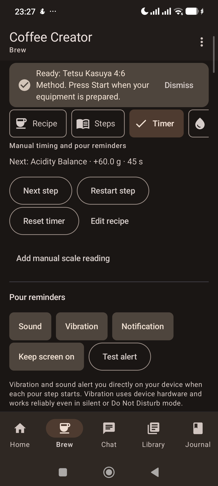
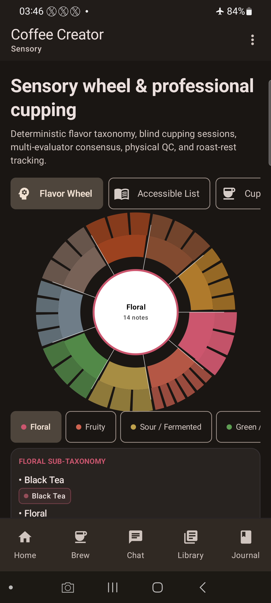
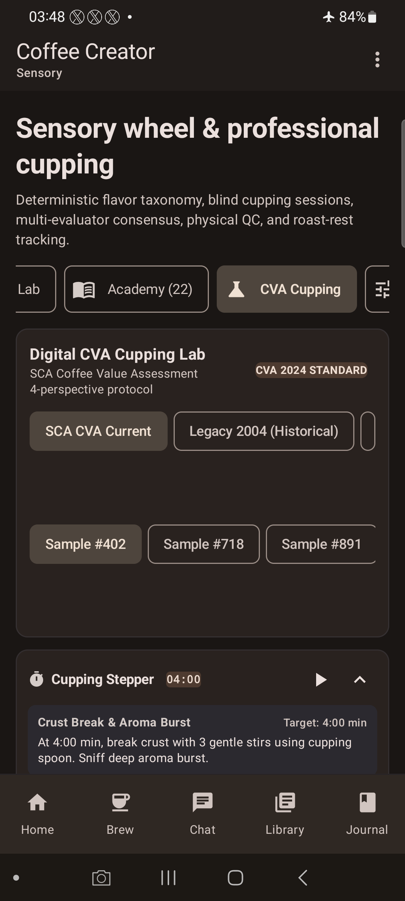
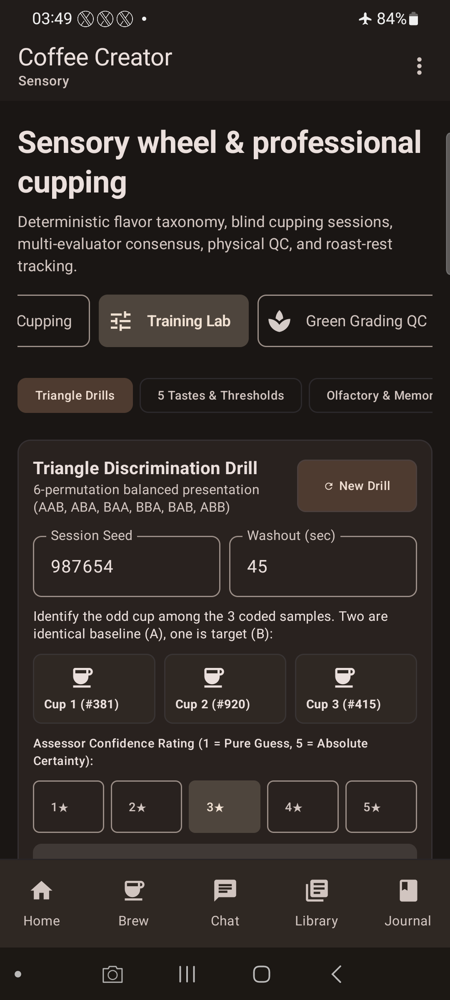
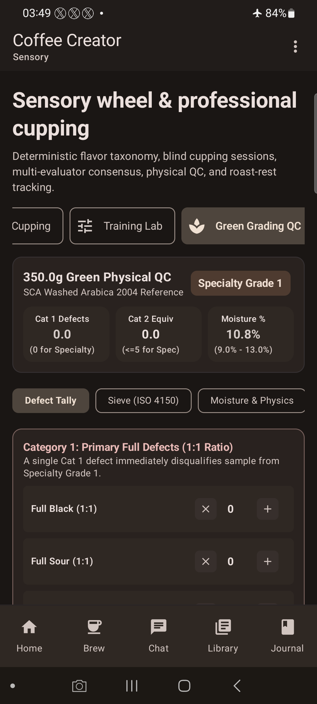
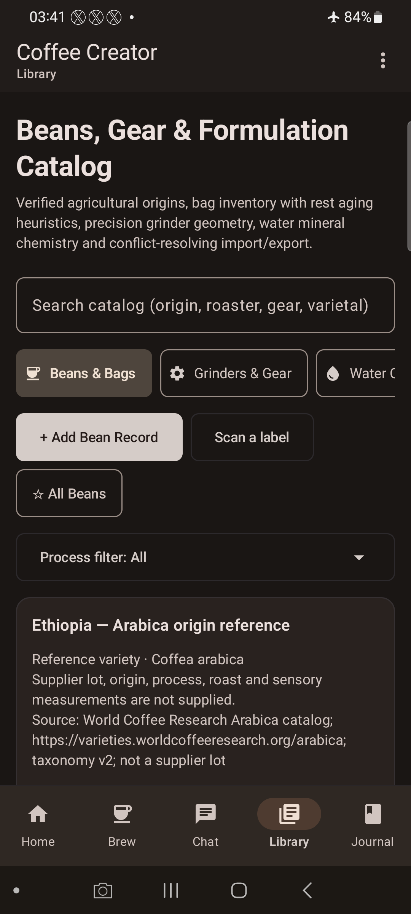
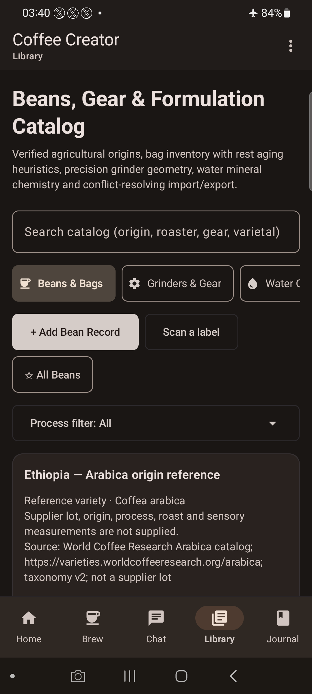
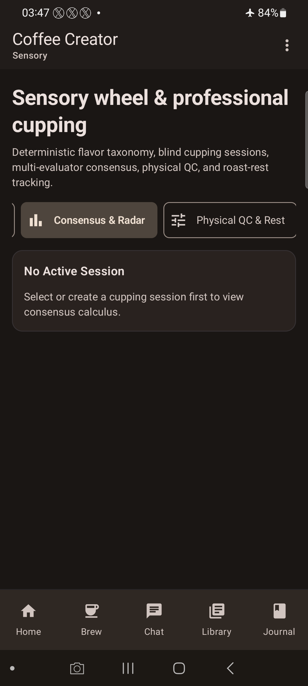
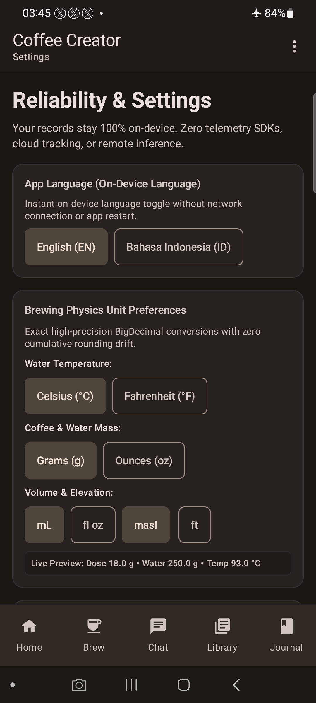
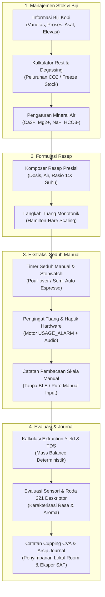

# Coffee Creator

Aplikasi Android *offline-first* untuk formulasi resep kopi presisi, timer seduh manual dengan getaran haptik langsung, evaluasi sensori dan cupping CVA, serta asisten AI lokal. Dibangun dengan Kotlin, Jetpack Compose, dan Material 3 mengadopsi standar desain *2026 Tactile Industrial*.

[Unduh APK Terbaru](#unduh-versi-terbaru) · [Tampilan Layar](#tampilan-antarmuka-aktual) · [Fitur & Batasan](#fitur-utama--batasan-aktual) · [Alur Pengguna](#alur-pengguna-user-journey) · [Tech Stack](#tech-stack--arsitektur) · [Panduan Build](#build-dan-pengujian) · [Riwayat Rilis](#arsip-riwayat-rilis--unduhan)

**Versi sumber:** `1.14.7` · Android 8.0+ (API 26–35) · Universal `arm64-v8a` & `x86_64`

---

## Unduh Versi Terbaru

### 🚀 **Coffee Creator v1.14.7** (Direct Hardware Haptics, Alarm-Grade Audio Cues & Test Alert)

| Paket Distribusi | Ukuran File | Checksum SHA-256 | Kompatibilitas Sistem |
|:---:|:---:|:---:|:---:|
| [⬇️ **Unduh coffee-creator-v1.14.7.apk**](https://github.com/Adrian463588/coffee-creator/releases/download/v1.14.7/coffee-creator-v1.14.7.apk) | `117,4 MB` (123.118.229 byte) | `70e5313cc9db8c4297b37bc827c7cbf6d226f31667bbe3060e246a8890726774` | Android 8.0 s/d Android 15 (API 26–35)<br>`arm64-v8a`, `x86_64` |

- 📋 [Catatan Rilis v1.14.7](docs/releases/v1.14.7.md)
- 🔒 [SHA256SUMS.txt](https://github.com/Adrian463588/coffee-creator/releases/download/v1.14.7/SHA256SUMS.txt)
- 📱 **Perangkat Uji & Verifikasi Fisik**: Samsung Galaxy S20 Ultra 5G (`SM-G988B`, Android 13 / One UI 5.1 / API 33).

#### 🛠️ Perintah Instalasi ADB Zero-Data-Loss (Direkomendasikan untuk Barista & Developer)
Untuk memperbarui aplikasi pada perangkat Android tanpa menghapus data resep, biji kopi, formulir cupping, atau riwayat journal:

```powershell
adb -s QSWSEMRKNFZ9LJRC install --user 0 -r -d coffee-creator-v1.14.7.apk
```

> [!IMPORTANT]
> Opsi `-r` mempertahankan seluruh data privat Room database, preferensi DataStore, dan berkas lokal. Opsi `-d` mengizinkan pembaruan versi secara aman tanpa wipe. **Jangan** menjalankan `adb uninstall` bila ingin menyimpan data, karena uninstalasi di Android akan menghapus seluruh basis data lokal aplikasi dan mencabut izin folder SAF. APK ditandatangani menggunakan sertifikat Android Debug.

---

## Tampilan Antarmuka Aktual

Tangkapan layar otentik yang diambil langsung dari perangkat fisik **Samsung Galaxy S20 Ultra 5G (`SM-G988B`)** dengan tema gelap dan tipografi angka tabular (*tnum*).

### Galeri 1: ☕ Workbench, Formulasi Resep & Timer Seduh Manual

| 01. Workbench Beranda | 02. Komposer Resep Ilmiah | 03. Timer Seduh Manual | 04. Pengingat & Haptik |
|:---:|:---:|:---:|:---:|
|  |  |  |  |
| **Workbench & Navigasi Cepat**<br>Status offline, riwayat revisi seduh, dan bilah navigasi taktil. | **Kalkulator Rasio & Skala**<br>Skala monotonic Hamilton-Hare, rasio air-kopi, dan preset metode. | **Manual Chronometer Armed**<br>Penghitung waktu langkah pour-over dan target espresso manual. | **Konsol Pengingat Tuang**<br>Getaran motorik langsung via `USAGE_ALARM`, audio alarm, dan tombol uji. |

---

### Galeri 2: 🎯 Sensori Kopi, Form CVA & Kendali Mutu Biji Hijau

| 05. Roda Sensori 221 Deskriptor | 06. Form Cupping CVA Digital | 07. Lab Pelatihan Sensori | 08. QC Fisik Biji Hijau |
|:---:|:---:|:---:|:---:|
|  |  |  |  |
| **Roda Rasa Interaktif**<br>221 deskriptor dwibahasa (ID/EN) terbagi dalam 9 keluarga sensori. | **Sistem Cupping CVA**<br>Protokol CVA deskriptif & afektif, grid cacat 5-mangkuk, dan segel sesi. | **Uji Segitiga Buta (Triangle Test)**<br>6 permutasi seimbang, kunci acak, dan kalkulasi binomial $P(X \ge k)$. | **Grading Biji Arabika 350g**<br>Klasifikasi cacat primer & sekunder SCA 2004 serta distribusi ayakan ISO 4150. |

---

### Galeri 3: ⚙️ Inventaris Peralatan, Profil Biji & Kalibrasi Panel

| 09. Katalog Grinder & Dripper | 10. Stok Kantong & Degassing | 11. Radar Kalibrasi Panel | 12. Monitor Degradasi Sistem |
|:---:|:---:|:---:|:---:|
|  |  |  |  |
| **44 Grinder & 26 Dripper**<br>Rentang gilingan mikron/klik serta kompatibilitas filter paper. | **Kinetika Rest & Pembekuan**<br>Kurva peluruhan degassing CO₂ dan deduksi dosis taktil. | **Konsensus Antar-Penilai**<br>Statistik keselarasan evaluator (Pearson $r$, Fleiss $\kappa$, MCD $\le 0.35$). | **Status Sub-Sistem Graceful**<br>Pemantauan fallback tanpa crash, preferensi unit (°C/°F), dan izin SAF. |

---

## Overview & Misi Proyek

**Coffee Creator** dirancang untuk barista profesional, roaster, grader kopi, dan home brewer yang menginginkan aplikasi pencatat dan perumus kopi yang **bersih dari AI slop**, deterministik, dan dapat diandalkan sepenuhnya di meja seduh (*coffee bar*).

### 🛡️ Tiga Prinsip Utama:
1. **100% Offline-First & Privasi Mutlak**: Beroperasi penuh dalam *airplane mode*. Tidak ada analitik pihak ketiga, tidak ada pelacakan telemetri latar belakang, dan tidak ada pengunggahan data resep atau lot pemasok ke cloud. Jaringan hanya digunakan bila pengguna secara eksplisit mengunduh model LLM/OCR lokal.
2. **Sains Ekstraksi Deterministik**: Modul perhitungan murni Kotlin JVM (`core/engine`) terisolasi dari framework Android dan Room. Menghitung mass-balance extraction yield ($EY = \frac{\text{beverage\_mass} \times \text{TDS}}{\text{dose}}$), kalkulasi refraktometer Brix-ke-TDS, kimia mineral air ($Ca^{2+}, Mg^{2+}, Na^+, HCO_3^- \to GH/KH/TDS$), dan kurva peluruhan degassing sangrai.
3. **Standar Desain 2026 Tactile Industrial**: Mikro-interaksi taktil berfisika pegas (`scale = 0.97f`), border hairline $1\text{px}$ kontras terukur (`outlineVariant` 0.40f), radius konsentris bertingkat ($R_{\text{inner}} = \max(0, R_{\text{outer}} - P)$), dan tipografi angka tabular (*tnum*) agar nilai numerik tidak bergeser saat waktu berjalan.

---

## Fitur Utama & Batasan Aktual

Aplikasi ini mengedepankan transparansi teknis dan kejujuran fitur (*truth in advertising*):

- **Resep & Ekstraksi Ilmiah:**
  - Penyusunan resep pour-over, espresso, immersion, dan cold brew.
  - Skala monotonic Hamilton-Hare untuk penyesuaian dosis dan air seduh yang proporsional.
  - Alur 1-klik *Brew Again* langsung dari kartu Journal atau katalog resep ke timer seduh.
- **Timer Seduh Manual & Stopwatch Espresso:**
  - **Timer Manual Murni:** Timer berfungsi sebagai stopwatch barista manual untuk langkah pour-over dan shot espresso (kompatibel dengan mesin manual/semi-otomatis seperti Xiaomi, Nuova Simonelli Appia, Ferratti Ferro).
  - **Pemberitahuan Batasan Hardware (Tanpa BLE):** Fitur integrasi Bluetooth Low Energy (BLE) smart-scale dan kendali otomatis mesin telah **dihapus**. Nama mesin hanya berfungsi sebagai metadata peralatan. Barista memasukkan pembacaan timbangan secara manual melalui tombol `Add manual scale reading`.
- **Pengingat Tuang & Getaran Hardware Langsung (`BrewVibrator`):**
  - Memicu getaran langsung ke motor vibrasi fisik perangkat menggunakan `AudioAttributes.USAGE_ALARM`. Bergetar andal bahkan saat mode *Do Not Disturb* (DND), mode tidur (*Bedtime*), atau saat *haptic feedback* sistem dinonaktifkan.
  - Opsi nada alarm audio (`BrewAudioPlayer`) dan notifikasi status bar Android berprioritas tinggi.
  - Tombol **Test alert** tersedia pada konsol timer untuk memverifikasi getaran motor dan speaker sebelum mulai menyeduh.
- **Roda Sensori 221 Deskriptor & Form Cupping CVA:**
  - 221 deskriptor rasa dwibahasa (Indonesia & Inggris) terbagi dalam 9 keluarga sensori.
  - Pratinjau form cupping digital SCA CVA (Descriptive, Affective, Physical, Extrinsic) dan grid cacat 5-mangkuk.
  - Catatan batasan: Implementasi form CVA saat ini berstatus eksplorasi/draft pratinjau; bukti audit historis tersedia pada [Laporan Kesiapan Sprint 04](docs/qa/RELEASE_READINESS_SPRINT_04.md).
- **AI Lokal & Pemrosesan Dokumen On-Device:**
  - Asisten lokal berbasis runtime `llama.cpp` JNI (model Kafi 1B GGUF) beroperasi lokal di CPU perangkat. Model Gemma 4 LiteRT-LM saat ini berstatus pengunduhan/pratinjau.
  - Pencarian dokumen PDF panduan seduh lokal berbasis embedding on-device MiniLM dan indeks vektor ObjectBox HNSW tanpa API cloud.

---

## Alur Pengguna (User Journey)



---

## Tech Stack & Arsitektur

Dibangun dengan arsitektur *Clean Architecture* dan modul Kotlin murni:

| Lapisan Arsitektur | Teknologi / Pustaka | Peran & Batasan |
|:---|:---|:---|
| **Presentasi (UI)** | Jetpack Compose, Material 3, ViewModel | Unidirectional Data Flow, `StateFlow`, `collectAsStateWithLifecycle`, preview responsif. |
| **Mesin Sains Kopi** | Pure Kotlin JVM (`core/engine`) | Nol dependensi Android/Room. Perhitungan presisi tinggi BigDecimal dan validasi domain. |
| **Penyimpanan Lokal** | Room ORM, SQLite, AndroidX DataStore | Skema migrasi aditif Room, integritas relasi foreign key, penyimpanan preferensi pengguna. |
| **Indeks Vektor & AI** | ObjectBox HNSW, ONNX Runtime, llama.cpp JNI | Pencarian kemiripan teks lokal, representasi vektor MiniLM, dan inferensi LLM offline. |
| **Sistem & Perangkat** | Android Service, VibratorManager, SAF | Foreground Service berprioritas tinggi, motor haptik `USAGE_ALARM`, manajemen file SAF. |

---

## Struktur Repositori

```
CoffeeCreator/
├── app/                                    # Modul aplikasi Android utama
│   ├── src/main/java/com/coffeecreator/app/
│   │   ├── core/
│   │   │   ├── ai/                         # Adapter LLM lokal, ONNX, dan ObjectBox
│   │   │   ├── brew/                       # Controller timer, BrewVibrator, BrewAudioPlayer
│   │   │   ├── engine/                     # Sains kopi murni Kotlin JVM (rasio, EY, TDS, mineral)
│   │   │   ├── filesystem/                 # Adapter Storage Access Framework (SAF) & Preferences
│   │   │   └── model/                      # Kontrak data immutable dan validasi domain
│   │   └── ui/
│   │       ├── screens/                    # Layar Compose (Brew, Timer, Sensory, Cupping, Grinders)
│   │       ├── theme/                      # Tema Material 3 & token 2026 Tactile Industrial
│   │       └── viewmodel/                  # UDF ViewModel berorientasi StateFlow
│   └── src/test/java/                      # 429 unit test (JVM Engine, DAOs, Robolectric Compose)
├── coffee-creator-blueprint/               # Dokumen spesifikasi otoritatif (PRD, Arsitektur, Desain)
├── docs/                                   # Dokumentasi rilis, bukti QA, dan lisensi
│   ├── releases/                           # Catatan rilis historis (v1.0.0 s/d v1.14.7)
│   ├── screenshots/                        # Galeri tangkapan layar perangkat fisik S20 Ultra
│   └── THIRD_PARTY.md                      # Atribusi komponen & dependensi pihak ketiga
└── scripts/                                # Skrip verifikasi aset, konsistensi README, dan build
```

---

## Build dan Pengujian

### Persyaratan Lingkungan
- Java Development Kit: **JDK 21**
- Android SDK: **Platform 35**, Build-Tools **35.0.0**
- Android NDK: **27.0.12077973**, CMake **3.22.1**
- Python: **3.11+**

### 1. Verifikasi Konsistensi & Pemeriksaan Aset
Jalankan skrip pemeriksaan integritas README dan aset lokal sebelum melakukan kompilasi:

```powershell
python scripts/check_readme_consistency.py
python scripts/test_check_readme_consistency.py
python scripts/prepare_assets.py
```

### 2. Pemeriksaan Linting & Analisis Statis
```powershell
# Detekt static code analysis
.\gradlew.bat :app:detekt

# Ktlint code formatting check
.\gradlew.bat :app:ktlintCheck

# Android Lint
.\gradlew.bat :app:lintDebug
```

### 3. Eksekusi Unit & UI Test
```powershell
.\gradlew.bat :app:testDebugUnitTest
```
*(Seluruh 429 pengujian unit test dan Robolectric lolos tanpa kegagalan).*

### 4. Kompilasi APK Debug
```powershell
.\gradlew.bat :app:assembleDebug
```
Berkas APK yang dihasilkan berada di: `app/build/outputs/apk/debug/app-debug.apk`.

---

## Arsip Riwayat Rilis & Unduhan

Seluruh arsip versi dapat diunduh langsung untuk memudahkan instalasi versi historis maupun pengujian komparatif:

<details>
<summary><strong>📦 Klik untuk melihat daftar lengkap riwayat rilis (v1.0.0 s/d v1.14.7)</strong></summary>

| Versi | Tanggal | Tautan Unduhan APK | Catatan Rilis & Sorotan Fitur | Checksum SHA-256 |
|:---:|:---:|:---:|:---|:---:|
| **v1.14.7** | 2026-10-25 | [Unduh APK](https://github.com/Adrian463588/coffee-creator/releases/download/v1.14.7/coffee-creator-v1.14.7.apk) | [Catatan](docs/releases/v1.14.7.md) · **Direct Hardware Haptics & Alarm Audio**: Getaran motor fisik langsung via `USAGE_ALARM` menembus mode DND/senyap, audio pengingat tuang, dan tombol `Test alert` di konsol timer. | `70e5313cc9db8c4297b37bc827c7cbf6d226f31667bbe3060e246a8890726774` |
| **v1.14.6** | 2026-10-25 | [Unduh APK](https://github.com/Adrian463588/coffee-creator/releases/download/v1.14.6/coffee-creator-v1.14.6.apk) | [Catatan](docs/releases/v1.14.6.md) · **1-Click Journal Replay & Responsive Facts**: Alur seduh ulang dari Journal, grid fakta 2×2 responsif tanpa squishing, dan stopwatch manual espresso. | `4bf0889c49f107de2341432ad3de19f25d38f8ea1c2c83180a182d42d881f77e` |
| **v1.14.5** | 2026-10-18 | [Unduh APK](https://github.com/Adrian463588/coffee-creator/releases/download/v1.14.5/coffee-creator-v1.14.5.apk) | [Catatan](docs/releases/v1.14.5.md) · **2026 Tactile Industrial UI/UX**: Pustaka komponen taktil berfisika pegas (`scale = 0.97f`), radius konsentris, border hairline, angka monospace tabular (`tnum`). | `447ccdde1cafc1799bb6a11af4e4c32a1344a4e11708beea64ec1fc2621a0f09` |
| **v1.14.4** | 2026-10-18 | [Unduh APK](https://github.com/Adrian463588/coffee-creator/releases/download/v1.14.4/coffee-creator-v1.14.4.apk) | [Catatan](docs/releases/v1.14.4.md) · **Sprint 04 Epic E: Pro Operations**: Operasi offline 100%, migrasi Room aditif aman, audit blind panel, kalibrasi panel consensus radar (MCD $\le 0.35$). | `a931abbccb6aa77806e85fa677ca774ab33608aa0ac99397bb63c3d8d478bc0f` |
| **v1.14.3** | 2026-10-18 | [Unduh APK](https://github.com/Adrian463588/coffee-creator/releases/download/v1.14.3/coffee-creator-v1.14.3.apk) | [Catatan](docs/releases/v1.14.3.md) · **Sprint 04 Epic D: Green Coffee QC**: Penilaian cacat biji hijau 350g SCA 2004, distribusi ayakan ISO 4150, densitas g/L, dan aktivitas air ($a_w$). | `e377bf4d7ad806b107316856fdacd227c2f7a744df25988e168e27330126563e` |
| **v1.14.2** | 2026-10-18 | [Unduh APK](https://github.com/Adrian463588/coffee-creator/releases/download/v1.14.2/coffee-creator-v1.14.2.apk) | [Catatan](docs/releases/v1.14.2.md) · **Sprint 04 Epic C: Sensory Training**: Uji diskriminasi segitiga (Triangle Testing) 6 permutasi seimbang, kalkulasi binomial kumulatif, 60 vial aroma. | `8eff8a4e7feda6e15c0acc66c8cd04594c3dac3d9a14b788e5115abd377e9f06` |
| **v1.14.1** | 2026-10-18 | [Unduh APK](https://github.com/Adrian463588/coffee-creator/releases/download/v1.14.1/coffee-creator-v1.14.1.apk) | [Catatan](docs/releases/v1.14.1.md) · **Sprint 04 Epic B: Digital CVA Cupping**: Form CVA multidimensi, modal roda sensori 221 deskriptor, grid cacat 5-mangkuk, dan segel kriptografi SHA-256. | `f2415b498e4fb47cf88b7cd7039e34d13605c9a86323c3bc54d8c3d4257b38f0` |
| **v1.14.0** | 2026-10-17 | [Unduh APK](https://github.com/Adrian463588/coffee-creator/releases/download/v1.14.0/coffee-creator-v1.14.0.apk) | [Catatan](docs/releases/v1.14.0.md) · **Sprint 04 Sensory Academy & CVA**: 22 modul edukasi sensori dwibahasa, atlas 7 asam organik, taksonomi aroma, dan protokol evaluasi CVA. | `350fe44ffeb475a38d157e6fc8d1ce82a441260735a568536bcf89f607bb4470` |
| **v1.13.1** | 2026-10-17 | [Unduh APK](https://github.com/Adrian463588/coffee-creator/releases/download/v1.13.1/coffee-creator-v1.13.1.apk) | [Catatan](docs/releases/v1.13.1.md) · **Microinteractions Refinement**: Grid rentang gilingan 3-kolom monospace, switch katup interaktif, dan akordeon kalibrasi zero-point. | `5b0a0f542cc2e0513b73fd430af555d44032f61810c1f3a62e2c3ff312ee233f` |
| **v1.13.0** | 2026-10-17 | [Unduh APK](https://github.com/Adrian463588/coffee-creator/releases/download/v1.13.0/coffee-creator-v1.13.0.apk) | [Catatan](docs/releases/v1.13.0.md) · **Sprint 03 Grinder & Dripper Intelligence**: Katalog 44 grinder dan 26 dripper, panduan kalibrasi titik nol, kompatibilitas kertas saring. | `ba15137a41234ac79724952e2432d83c325e9a88803eecc6f3a0c838ae5caa52` |
| **v1.12.2** | 2026-10-17 | [Unduh APK](https://github.com/Adrian463588/coffee-creator/releases/download/v1.12.2/coffee-creator-v1.12.2.apk) | [Catatan](docs/releases/v1.12.2.md) · **Tactile UI/UX Primitives**: Standarisasi tombol taktil berpegas, batasan teks baris tunggal, dan pemasangan zero-data-loss `-r -d`. | `f7358795ea6ee155c030cc09d4c8a7bd7fbede06a12f7c533841fd3bc775c2a0` |
| **v1.12.1** | 2026-10-17 | [Unduh APK](https://github.com/Adrian463588/coffee-creator/releases/download/v1.12.1/coffee-creator-v1.12.1.apk) | [Catatan](docs/releases/v1.12.1.md) · **Zero-Crash Resilience**: Kaskade resolusi resep defensif 5 tingkat, penanganan coroutine aman pada sesi seduh dan tara. | `0b381b2367476201f4e1749af8fc8fbcc273b3f2ee107945331ca19eda392da0` |
| **v1.12.0** | 2026-10-17 | [Unduh APK](https://github.com/Adrian463588/coffee-creator/releases/download/v1.12.0/coffee-creator-v1.12.0.apk) | [Catatan](docs/releases/v1.12.0.md) · **Sensory Deepening**: Integrasi taksonomi 221 deskriptor lengkap (84 SCA + 137 Indonesia/global) dan pencarian instan. | `727e73b709fa594ccb7c65f1a27890e20c55ae622c27ae179a5e0c86ca8419b8` |
| **v1.11.0** | 2026-10-17 | [Unduh APK](https://github.com/Adrian463588/coffee-creator/releases/download/v1.11.0/coffee-creator-v1.11.0.apk) | [Catatan](docs/releases/v1.11.0.md) · **80 World Champion Recipes**: Katalog resep juara dunia (Tetsu Kasuya 4:6, James Hoffmann, Scott Rao, Matt Perger). | `c63f74fcf3bc3461b24a6cdec9f4ac2b378b815c57b8449c05963852ccaa6f61` |
| **v1.10.2** | 2026-10-16 | [Unduh APK](https://github.com/Adrian463588/coffee-creator/releases/download/v1.10.2/coffee-creator-v1.10.2.apk) | [Catatan](docs/releases/v1.10.2.md) · **Tactile Settings & Telemetry**: Pengaturan format unit terpadu (°C/°F, g/oz), pemantau degradasi graceful. | `b5539ad55f333585dbdf76c1811ccfd19cd6399c10c6d325b080b4836d721f55` |
| **v1.10.1** | 2026-10-16 | [Unduh APK](https://github.com/Adrian463588/coffee-creator/releases/download/v1.10.1/coffee-creator-v1.10.1.apk) | [Catatan](docs/releases/v1.10.1.md) · **Adaptive Launcher Icon**: Ikon launcher presisi kopi vektor adaptif untuk tema terang dan gelap. | `a8cfc5fccb4ab081f6d95d33f6b3ce94e030341927e3f6719ff221c617be0a42` |
| **v1.10.0** | 2026-10-16 | [Unduh APK](https://github.com/Adrian463588/coffee-creator/releases/download/v1.10.0/coffee-creator-v1.10.0.apk) | [Catatan](docs/releases/v1.10.0.md) · **Debug Preview Release**: Pratinjau arsitektur modular-monolith dan engine JVM murni. | — |
| **v1.9.6** | 2026-10-16 | [Unduh APK](https://github.com/Adrian463588/coffee-creator/releases/download/v1.9.6/coffee-creator-v1.9.6.apk) | [Catatan](docs/releases/v1.9.6.md) · **Precision Ergonomics**: Tabular figures (`tnum`) eliminasi layout jitter pada seluruh tampilan numerik. | `d3d28471fdf73702d7b9016776552bbfc3ce72989c5cb8552c9d0e207e352c6f` |
| **v1.9.5** | 2026-10-16 | [Unduh APK](https://github.com/Adrian463588/coffee-creator/releases/download/v1.9.5/coffee-creator-v1.9.5.apk) | [Catatan](docs/releases/v1.9.5.md) · **Sensory Wheel Modal**: Modal seleksi multi-deskriptor dengan filter keluarga rasa dan komit kelompok. | — |
| **v1.9.4** | 2026-10-16 | [Unduh APK](https://github.com/Adrian463588/coffee-creator/releases/download/v1.9.4/app-debug.apk) | [Catatan](docs/releases/v1.9.4.md) · **BackHandler Sub-Screen**: Navigasi tombol kembali hardware konsisten kembali ke Home workbench. | — |
| **v1.9.3** | 2026-10-16 | [Unduh APK](https://github.com/Adrian463588/coffee-creator/releases/download/v1.9.3/coffee-creator-v1.9.3.apk) | [Catatan](docs/releases/v1.9.3.md) · **Anti-Slop Ergonomics**: Penghapusan distorsi tombol oval dengan pembatasan teks baris tunggal. | — |
| **v1.9.2** | 2026-10-15 | [Unduh APK](https://github.com/Adrian463588/coffee-creator/releases/download/v1.9.2/coffee-creator-v1.9.2.apk) | [Catatan](docs/releases/v1.9.2.md) · **Single-Line Horizontal Tabs**: Tab kategori Journal dan Sensori dapat digulir horizontal tanpa wrapping. | — |
| **v1.9.1** | 2026-10-15 | [Unduh APK](https://github.com/Adrian463588/coffee-creator/releases/download/v1.9.1/coffee-creator-v1.9.1.apk) | [Catatan](docs/releases/v1.9.1.md) · **Tactile Precision Lab**: Pengenalan mikro-depresi pegas taktil (`scale = 0.96f`). | — |
| **v1.9.0** | 2026-10-15 | [Unduh APK](https://github.com/Adrian463588/coffee-creator/releases/download/v1.9.0/coffee-creator-v1.9.0.apk) | [Catatan](docs/releases/v1.9.0.md) · **Bean & Equipment Foundation**: Manajemen varietas biji, inventaris kantong, dan kalkulator rest. | — |
| **v1.8.0** | 2026-10-15 | [Unduh APK](https://github.com/Adrian463588/coffee-creator/releases/download/v1.8.0/coffee-creator-v1.8.0.apk) | [Catatan](docs/releases/v1.8.0.md) · **Data Portability & Inclusivity**: Unduhan model HTTP 206 resumable dan FAQ pemulihan offline. | — |
| **v1.7.0** | 2026-10-15 | [Unduh APK](https://github.com/Adrian463588/coffee-creator/releases/download/v1.7.0/coffee-creator-v1.7.0.apk) | [Catatan](docs/releases/v1.7.0.md) · **Local AI & RAG Integration**: Integrasi awal runtime GGUF lokal dan embedding dokumen offline. | — |
| **v1.6.0** | 2026-10-15 | [Unduh APK](https://github.com/Adrian463588/coffee-creator/releases/download/v1.6.0/coffee-creator-v1.6.0.apk) | [Catatan](docs/releases/v1.6.0.md) · **Sensory Wheel & Cupping**: Roda rasa interaktif awal dan pencatatan atribut sensori. | — |
| **v1.5.0** | 2026-10-15 | [Unduh APK](https://github.com/Adrian463588/coffee-creator/releases/download/v1.5.0/app-debug.apk) | [Catatan](docs/releases/v1.5.0.md) · **Brew Journal & Analytics**: Riwayat seduh dan pelacakan konsistensi rasa. | — |
| **v1.4.0** | 2026-10-15 | [Unduh APK](https://github.com/Adrian463588/coffee-creator/releases/download/v1.4.0/app-debug.apk) | [Catatan](docs/releases/v1.4.0.md) · **Brew Timer Architecture**: Struktur awal chronometer dan langkah seduh pour-over. | — |
| **v1.3.0** | 2026-10-15 | [Unduh APK](https://github.com/Adrian463588/coffee-creator/releases/download/v1.3.0/app-debug.apk) | [Catatan](docs/releases/v1.3.0.md) · **Brewing Science Math**: Formula mass-balance ekstraksi yield dan kalkulator mineral air. | — |
| **v1.2.0** | 2026-10-15 | [Unduh APK](https://github.com/Adrian463588/coffee-creator/releases/download/v1.2.0/coffee-creator-v1.2.0.apk) | [Catatan](docs/releases/v1.2.0.md) · **Recipe Composer UI**: Antarmuka awal pengatur dosis, rasio air, dan suhu. | — |
| **v1.1.0** | 2026-10-15 | [Unduh APK](https://github.com/Adrian463588/coffee-creator/releases/download/v1.1.0/coffee-creator-v1.1.0.apk) | [Catatan](docs/releases/v1.1.0.md) · **Core Architecture**: Penyiapan modul Clean Architecture, Hilt DI, dan basis data Room. | — |
| **v1.0.0** | 2026-10-15 | [Unduh APK](https://github.com/Adrian463588/coffee-creator/releases/download/v1.0.0/coffee-creator-v1.0.0.apk) | Inisialisasi repositori, fondasi Jetpack Compose, dan kerangka Material 3. | — |

</details>

---

## Lisensi & Atribusi

- **Kode Sumber Aplikasi**: Lisensi kode sumber belum dinyatakan dalam repositori.
- **Komponen & Dependensi Pihak Ketiga**: Rincian atribusi lisensi untuk `llama.cpp`, `ONNX Runtime`, `Tesseract`, `ObjectBox`, dan pustaka `AndroidX` didokumentasikan lengkap pada [docs/THIRD_PARTY.md](docs/THIRD_PARTY.md).
- **Taksonomi Sensori & Kopi**: Bersumber dari penelitian terbuka World Coffee Research (WCR) dan standar rasa kopi Indonesia dengan penataan epistemologi independen.
