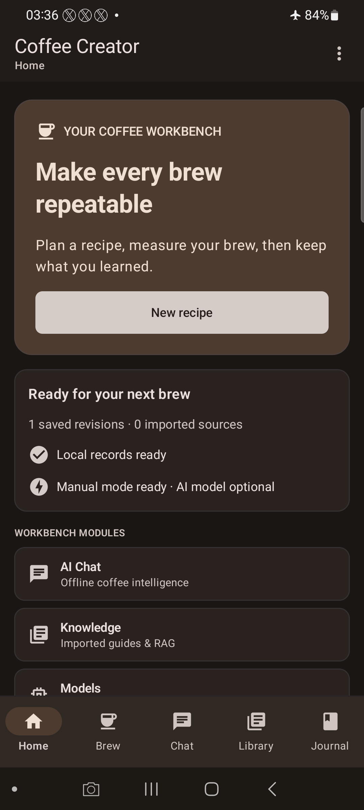
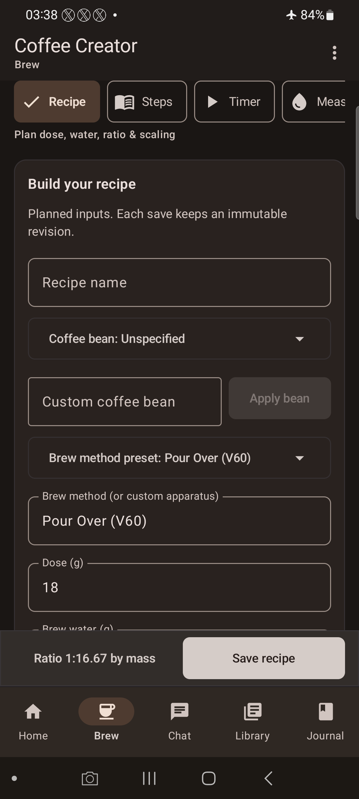
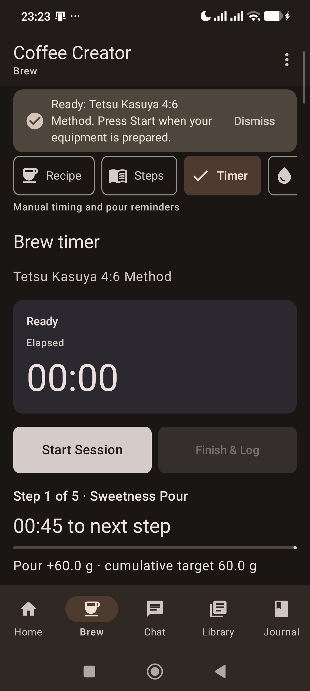

# Coffee Creator

Coffee Creator adalah aplikasi Android offline-first untuk menyusun resep kopi, menjalankan timer seduh manual, dan mencatat hasil. Aplikasi menggunakan Kotlin, Jetpack Compose, dan Material 3.

[Unduh APK terbaru](#unduh) · [Fitur dan batasan](#fitur-dan-batasan) · [Panduan build](#build-dan-pengujian) · [Semua rilis](https://github.com/Adrian463588/coffee-creator/releases)

**Versi sumber:** `1.14.7` · Android 8.0+ (API 26+) · `arm64-v8a` dan `x86_64`

## Unduh

[**Unduh Coffee Creator v1.14.7 (APK debug)**](https://github.com/Adrian463588/coffee-creator/releases/download/v1.14.7/coffee-creator-v1.14.7.apk)

- Ukuran: 123.118.229 byte (sekitar 123,1 MB atau 117,4 MiB).
- SHA-256: `70e5313cc9db8c4297b37bc827c7cbf6d226f31667bbe3060e246a8890726774`.
- [Catatan rilis](docs/releases/v1.14.7.md) · [SHA256SUMS.txt](https://github.com/Adrian463588/coffee-creator/releases/download/v1.14.7/SHA256SUMS.txt) · [Arsip versi](#riwayat-rilis).

APK ini ditandatangani dengan sertifikat **Android Debug**. Sebelum memasang versi lain, ekspor dan periksa cadangan data penting. Pemasangan ulang dengan sertifikat yang berbeda dapat ditolak; menghapus aplikasi dapat menghapus data privat dan mencabut izin folder yang dipilih.

## Fitur dan batasan

- **Resep dan Journal:** susun resep dan langkah tuang, simpan revisi, serta siapkan ulang resep dari Journal menuju timer.
- **Timer seduh manual:** jalankan langkah pour-over atau stopwatch espresso; masukkan pembacaan timbangan sendiri. Nama mesin hanyalah informasi peralatan: aplikasi tidak mengontrol mesin dan tidak mendukung koneksi timbangan atau mesin fisik melalui BLE.
- **Pengingat:** opsi suara, getaran, dan notifikasi tersedia pada timer. Hasilnya bergantung pada izin, pengaturan suara/Do Not Disturb, dan perangkat; gunakan tombol uji sebelum menyeduh.
- **Katalog dan perhitungan:** kelola biji, stok, grinder, dripper dan resep; hitung rasio dan perkiraan extraction yield dari data yang dimasukkan. Pengurangan stok dilakukan oleh pengguna. Nilai TDS dan berat minuman harus berasal dari pengukuran pengguna.
- **Sensori dan cupping:** roda deskriptor, materi latihan, dan layar eksplorasi CVA tersedia. Formulir CVA Sprint 04 masih berupa draft sementara yang tidak disimpan sebagai sesi; pemetaan dan izin formulir resmi belum diverifikasi. Latihan virtual bukan bukti uji sensori fisik.
- **AI lokal dan dokumen:** model dan dokumen dapat dipilih secara lokal; model AI opsional dan pengunduhan memerlukan internet. Kafi dan model GGUF kompatibel menggunakan runtime lokal; Gemma 4 LiteRT-LM saat ini hanya dapat diunduh, belum dapat digunakan untuk inferensi di aplikasi. Hasil AI tetap perlu ditinjau pengguna.

Implementasi dan penerimaan seluruh fitur lintas sprint belum sepenuhnya diverifikasi. [Laporan audit Sprint 04](docs/qa/RELEASE_READINESS_SPRINT_04.md) adalah bukti historis untuk baseline yang disebut di laporan, bukan hasil pengujian terbaru.

## Tampilan aplikasi

Tangkapan layar yang tersimpan di repositori. Versi dan isi layar dapat berbeda dari versi terbaru.

| Home · v1.14.5 | Resep · v1.14.5 | Timer · v1.14.7 |
| :---: | :---: | :---: |
|  |  |  |

## Penyimpanan dan privasi

Resep dan catatan aplikasi disimpan secara lokal, termasuk data privat aplikasi. Folder SAF dipakai untuk aset atau ekspor yang dipilih pengguna; jangan menganggap seluruh data pribadi berada di folder tersebut. Ekspor cadangan dan verifikasi hasilnya sebelum mengganti perangkat atau menghapus aplikasi. Setelah pemasangan ulang, izin SAF mungkin perlu diberikan kembali.

## Build dan pengujian

Persyaratan: JDK 21, Android SDK 35 dan Build Tools 35.0.0, NDK `27.0.12077973`, CMake `3.22.1`, serta Python 3.11+. Instal SDK melalui Android Studio, lalu jalankan dari akar repositori:

```powershell
python scripts/prepare_assets.py
.\gradlew.bat :app:lintDebug :app:detekt :app:ktlintCheck :app:testDebugUnitTest :app:assembleDebug
```

`prepare_assets.py` mengunduh dan memeriksa aset build; CMake juga mengambil sumber native yang dipin. APK debug hasil build berada di `app/build/outputs/apk/debug/app-debug.apk`.

Status tes bergantung pada commit dan lingkungan. Lihat [GitHub Actions](https://github.com/Adrian463588/coffee-creator/actions) untuk hasil terkini. Audit dokumentasi pada 28 Oktober 2026 mencatat [satu tes UI gagal pada CI](https://github.com/Adrian463588/coffee-creator/actions/runs/40224043529); tes perangkat dan penerimaan menyeluruh tidak dijalankan dalam audit tersebut.

CI memeriksa label versi sumber, keberadaan tautan lokal README, dan tanda berkas PNG. Saat menyiapkan rilis, pengelola tetap perlu membandingkan klaim fitur dengan kode serta memeriksa nama, checksum, dan tautan aset GitHub; pemeriksaan lokal tidak membuktikan perilaku aplikasi.

## Struktur

- `app/src/main/java/com/coffeecreator/app/ui/` — layar Compose dan ViewModel.
- `app/src/main/java/com/coffeecreator/app/core/` — model, perhitungan, penyimpanan, timer, dan adapter AI.
- `coffee-creator-blueprint/` — PRD, arsitektur, dan panduan desain.
- `docs/qa/` — audit dan bukti pengujian yang diberi tanggal.
- `docs/releases/` — catatan rilis historis.

## Riwayat rilis

Arsip berikut mempertahankan tautan unduhan setiap versi yang tersedia. Catatan lama adalah catatan historis dan dapat memuat klaim yang belum diverifikasi untuk versi saat ini.

<details>
<summary>Lihat arsip APK v1.0.0–v1.14.7</summary>

| Versi | Unduh | Catatan |
| --- | --- | --- |
| [v1.14.7](https://github.com/Adrian463588/coffee-creator/releases/tag/v1.14.7) | [APK](https://github.com/Adrian463588/coffee-creator/releases/download/v1.14.7/coffee-creator-v1.14.7.apk) | [Catatan](docs/releases/v1.14.7.md) |
| [v1.14.6](https://github.com/Adrian463588/coffee-creator/releases/tag/v1.14.6) | [APK](https://github.com/Adrian463588/coffee-creator/releases/download/v1.14.6/coffee-creator-v1.14.6.apk) | [Catatan](docs/releases/v1.14.6.md) |
| [v1.14.5](https://github.com/Adrian463588/coffee-creator/releases/tag/v1.14.5) | [APK](https://github.com/Adrian463588/coffee-creator/releases/download/v1.14.5/coffee-creator-v1.14.5.apk) | [Catatan](docs/releases/v1.14.5.md) |
| [v1.14.4](https://github.com/Adrian463588/coffee-creator/releases/tag/v1.14.4) | [APK](https://github.com/Adrian463588/coffee-creator/releases/download/v1.14.4/coffee-creator-v1.14.4.apk) | [Catatan](docs/releases/v1.14.4.md) |
| [v1.14.3](https://github.com/Adrian463588/coffee-creator/releases/tag/v1.14.3) | [APK](https://github.com/Adrian463588/coffee-creator/releases/download/v1.14.3/coffee-creator-v1.14.3.apk) | [Catatan](docs/releases/v1.14.3.md) |
| [v1.14.2](https://github.com/Adrian463588/coffee-creator/releases/tag/v1.14.2) | [APK](https://github.com/Adrian463588/coffee-creator/releases/download/v1.14.2/coffee-creator-v1.14.2.apk) | [Catatan](docs/releases/v1.14.2.md) |
| [v1.14.1](https://github.com/Adrian463588/coffee-creator/releases/tag/v1.14.1) | [APK](https://github.com/Adrian463588/coffee-creator/releases/download/v1.14.1/coffee-creator-v1.14.1.apk) | [Catatan](docs/releases/v1.14.1.md) |
| [v1.14.0](https://github.com/Adrian463588/coffee-creator/releases/tag/v1.14.0) | [APK](https://github.com/Adrian463588/coffee-creator/releases/download/v1.14.0/coffee-creator-v1.14.0.apk) | [Catatan](docs/releases/v1.14.0.md) |
| [v1.13.1](https://github.com/Adrian463588/coffee-creator/releases/tag/v1.13.1) | [APK](https://github.com/Adrian463588/coffee-creator/releases/download/v1.13.1/coffee-creator-v1.13.1.apk) | [Catatan](docs/releases/v1.13.1.md) |
| [v1.13.0](https://github.com/Adrian463588/coffee-creator/releases/tag/v1.13.0) | [APK](https://github.com/Adrian463588/coffee-creator/releases/download/v1.13.0/coffee-creator-v1.13.0.apk) | [Catatan](docs/releases/v1.13.0.md) |
| [v1.12.2](https://github.com/Adrian463588/coffee-creator/releases/tag/v1.12.2) | [APK](https://github.com/Adrian463588/coffee-creator/releases/download/v1.12.2/coffee-creator-v1.12.2.apk) | [Catatan](docs/releases/v1.12.2.md) |
| [v1.12.1](https://github.com/Adrian463588/coffee-creator/releases/tag/v1.12.1) | [APK](https://github.com/Adrian463588/coffee-creator/releases/download/v1.12.1/coffee-creator-v1.12.1.apk) | [Catatan](docs/releases/v1.12.1.md) |
| [v1.12.0](https://github.com/Adrian463588/coffee-creator/releases/tag/v1.12.0) | [APK](https://github.com/Adrian463588/coffee-creator/releases/download/v1.12.0/coffee-creator-v1.12.0.apk) | [Catatan](docs/releases/v1.12.0.md) |
| [v1.11.0](https://github.com/Adrian463588/coffee-creator/releases/tag/v1.11.0) | [APK](https://github.com/Adrian463588/coffee-creator/releases/download/v1.11.0/coffee-creator-v1.11.0.apk) | [Catatan](docs/releases/v1.11.0.md) |
| [v1.10.2](https://github.com/Adrian463588/coffee-creator/releases/tag/v1.10.2) | [APK](https://github.com/Adrian463588/coffee-creator/releases/download/v1.10.2/coffee-creator-v1.10.2.apk) | [Catatan](docs/releases/v1.10.2.md) |
| [v1.10.1](https://github.com/Adrian463588/coffee-creator/releases/tag/v1.10.1) | [APK](https://github.com/Adrian463588/coffee-creator/releases/download/v1.10.1/coffee-creator-v1.10.1.apk) | [Catatan](docs/releases/v1.10.1.md) |
| [v1.10.0](https://github.com/Adrian463588/coffee-creator/releases/tag/v1.10.0) | [APK](https://github.com/Adrian463588/coffee-creator/releases/download/v1.10.0/coffee-creator-v1.10.0.apk) | [Catatan](docs/releases/v1.10.0.md) |
| [v1.9.6](https://github.com/Adrian463588/coffee-creator/releases/tag/v1.9.6) | [APK](https://github.com/Adrian463588/coffee-creator/releases/download/v1.9.6/coffee-creator-v1.9.6.apk) | [Catatan](docs/releases/v1.9.6.md) |
| [v1.9.5](https://github.com/Adrian463588/coffee-creator/releases/tag/v1.9.5) | [APK](https://github.com/Adrian463588/coffee-creator/releases/download/v1.9.5/coffee-creator-v1.9.5.apk) | [Catatan](docs/releases/v1.9.5.md) |
| [v1.9.4](https://github.com/Adrian463588/coffee-creator/releases/tag/v1.9.4) | [APK](https://github.com/Adrian463588/coffee-creator/releases/download/v1.9.4/app-debug.apk) | [Catatan](docs/releases/v1.9.4.md) |
| [v1.9.3](https://github.com/Adrian463588/coffee-creator/releases/tag/v1.9.3) | [APK](https://github.com/Adrian463588/coffee-creator/releases/download/v1.9.3/coffee-creator-v1.9.3.apk) | [Catatan](docs/releases/v1.9.3.md) |
| [v1.9.2](https://github.com/Adrian463588/coffee-creator/releases/tag/v1.9.2) | [APK](https://github.com/Adrian463588/coffee-creator/releases/download/v1.9.2/coffee-creator-v1.9.2.apk) | [Catatan](docs/releases/v1.9.2.md) |
| [v1.9.1](https://github.com/Adrian463588/coffee-creator/releases/tag/v1.9.1) | [APK](https://github.com/Adrian463588/coffee-creator/releases/download/v1.9.1/coffee-creator-v1.9.1.apk) | [Catatan](docs/releases/v1.9.1.md) |
| [v1.9.0](https://github.com/Adrian463588/coffee-creator/releases/tag/v1.9.0) | [APK](https://github.com/Adrian463588/coffee-creator/releases/download/v1.9.0/coffee-creator-v1.9.0.apk) | [Catatan](docs/releases/v1.9.0.md) |
| [v1.8.0](https://github.com/Adrian463588/coffee-creator/releases/tag/v1.8.0) | [APK](https://github.com/Adrian463588/coffee-creator/releases/download/v1.8.0/coffee-creator-v1.8.0.apk) | [Catatan](docs/releases/v1.8.0.md) |
| [v1.7.0](https://github.com/Adrian463588/coffee-creator/releases/tag/v1.7.0) | [APK](https://github.com/Adrian463588/coffee-creator/releases/download/v1.7.0/coffee-creator-v1.7.0.apk) | [Catatan](docs/releases/v1.7.0.md) |
| [v1.6.0](https://github.com/Adrian463588/coffee-creator/releases/tag/v1.6.0) | [APK](https://github.com/Adrian463588/coffee-creator/releases/download/v1.6.0/coffee-creator-v1.6.0.apk) | [Catatan](docs/releases/v1.6.0.md) |
| [v1.5.0](https://github.com/Adrian463588/coffee-creator/releases/tag/v1.5.0) | [APK](https://github.com/Adrian463588/coffee-creator/releases/download/v1.5.0/app-debug.apk) | [Catatan](docs/releases/v1.5.0.md) |
| [v1.4.0](https://github.com/Adrian463588/coffee-creator/releases/tag/v1.4.0) | [APK](https://github.com/Adrian463588/coffee-creator/releases/download/v1.4.0/app-debug.apk) | [Catatan](docs/releases/v1.4.0.md) |
| [v1.3.0](https://github.com/Adrian463588/coffee-creator/releases/tag/v1.3.0) | [APK](https://github.com/Adrian463588/coffee-creator/releases/download/v1.3.0/app-debug.apk) | [Catatan](docs/releases/v1.3.0.md) |
| [v1.2.0](https://github.com/Adrian463588/coffee-creator/releases/tag/v1.2.0) | [APK](https://github.com/Adrian463588/coffee-creator/releases/download/v1.2.0/coffee-creator-v1.2.0.apk) | [Catatan](docs/releases/v1.2.0.md) |
| [v1.1.0](https://github.com/Adrian463588/coffee-creator/releases/tag/v1.1.0) | [APK](https://github.com/Adrian463588/coffee-creator/releases/download/v1.1.0/coffee-creator-v1.1.0.apk) | [Catatan](docs/releases/v1.1.0.md) |
| [v1.0.0](https://github.com/Adrian463588/coffee-creator/releases/tag/v1.0.0) | [APK](https://github.com/Adrian463588/coffee-creator/releases/download/v1.0.0/coffee-creator-v1.0.0.apk) | — |

</details>

## Lisensi dan atribusi

Lisensi kode sumber belum dinyatakan dalam repositori. Ketentuan komponen pihak ketiga dicatat di [docs/THIRD_PARTY.md](docs/THIRD_PARTY.md); model opsional memiliki ketentuan masing-masing.
